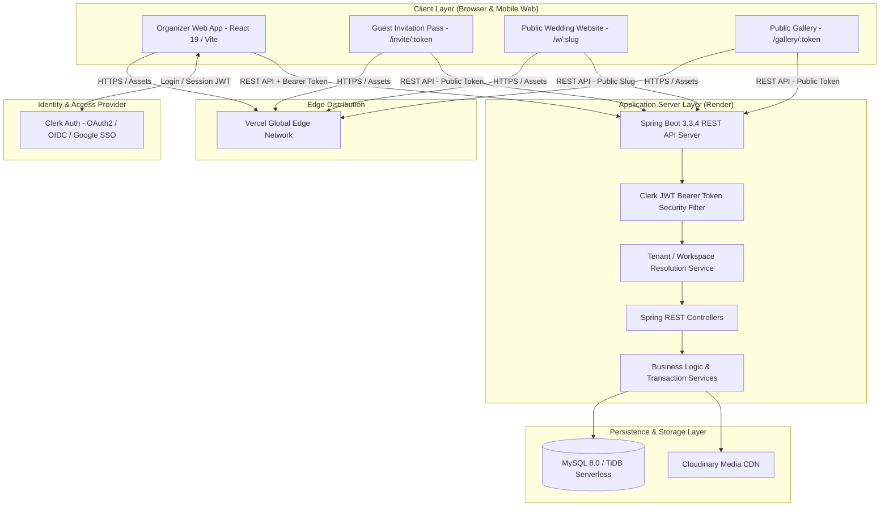
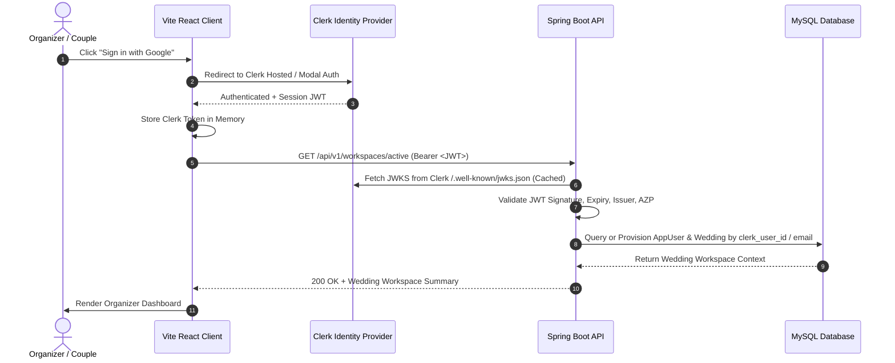
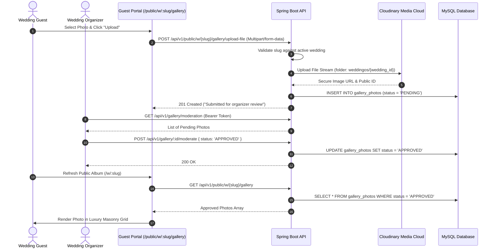

# WeddingOS — System Architecture & Technical Design

> **Document ID:** `DOC-02`  
> **Status:** Approved Master Architecture (v1.1 Production Release)  
> **Target Audience:** Engineering Students, Workshop Instructors, Technical Reviewers  
> **Source Repository:** `D:\Build_With__AI_TapAcademy\WeddingOS`

---

## 1. High-Level Architecture Overview

WeddingOS is structured as a **Decoupled Modern Web Architecture** consisting of an optimized Single Page Application (SPA) client and a stateless modular backend API.



---

## 2. Component Responsibilities & Boundaries

### 2.1 Frontend Client (`apps/web`)
- **Technology:** React 19, TypeScript, Vite, Tailwind CSS v4, React Router DOM 7.
- **Responsibilities:**
  - View orchestration and user journey navigation.
  - Client-side form validation, date manipulation, and currency formatting.
  - Optimistic client-side caching in `localStorage` for sub-50ms UI response times.
  - Intent-first RSVP state machine (zero QR on initial load; unlock entry QR pass upon acceptance).
  - Dynamic vanity slug generator (`generateUniqueSlug`) and real-time debounced availability validation.
  - Dynamic document title updates for SEO and UX (`[Bride] & [Groom] Wedding | WeddingOS`).
  - QR Code generation (`qrcode`) and real-time camera scanning (`html5-qrcode`).
  - Handling Clerk authentication tokens via `@clerk/clerk-react`.
  - Responsive design adapting dynamically from mobile viewports (320px) to 4K displays.

### 2.2 Backend API (`services/api`)
- **Technology:** Java 21 LTS, Spring Boot 3.3.4, Spring Data JPA / Hibernate, Spring Security OAuth2 Resource Server.
- **Responsibilities:**
  - Enforcing multi-tenant workspace isolation based on Clerk User ID and verified email.
  - Business rule and invariant validation (e.g., Last-Admin protection, check-in duplicate alerts, slug collision prevention).
  - Relational persistence and ACID transactions across 12 normalized tables.
  - Public unauthenticated gateway for tokenized guest passes (`/api/v1/public/invite/**`) and wedding portals (`/api/v1/public/w/**`).
  - Cloudinary API integration for streaming photo uploads and media transformations.
  - Serving interactive API documentation via SpringDoc OpenAPI 3 (`/swagger-ui.html`).

### 2.3 Relational Database (`weddingos_db`)
- **Technology:** MySQL 8.0+ / TiDB Serverless (InnoDB engine, utf8mb4 encoding).
- **Responsibilities:**
  - Strict foreign key constraints and referential integrity.
  - Unique constraints on Clerk User IDs, Wedding Slugs, and Invitation Tokens.
  - Optimized B-Tree indexes on tenant queries (`wedding_id`, `email`, `token`, `slug`).

---

## 3. Authentication & Authorization Flow

WeddingOS employs a **Stateless Bearer Token Architecture** utilizing Clerk as the identity provider.



### 3.1 Public vs. Protected Endpoints
- **Protected Organizer Routes:** Require valid Clerk JWT bearer tokens.
  - `/api/v1/workspaces/**`
  - `/api/v1/events/**` (Full CRUD)
  - `/api/v1/invitations/**` (Full CRUD)
  - `/api/v1/check-in/**` (Verification & Logging)
  - `/api/v1/tasks/**` (Kanban & Status toggles)
  - `/api/v1/expenses/**` (Full CRUD & Ledger transactions)
  - `/api/v1/vendors/**` (Full CRUD & Quotation balances)
  - `/api/v1/members/**` (Team Roster & 8-Module RBAC)
  - `/api/v1/website/**` (Website Studio Config)
  - `/api/v1/gallery/**` (Organizer Moderation Queue)

- **Public Guest Routes:** Require zero authentication; authorized via unguessable 128-bit tokens or vanity slugs.
  - `GET /api/v1/public/invite/{token}` — Fetch personalized invitation card, bride/groom metadata, and public website slug.
  - `POST /api/v1/public/invite/{token}/rsvp` — Submit RSVP attendance (`ATTENDING` / `NOT_ATTENDING`), headcounts, and dietary notes.
  - `GET /api/v1/public/w/{slug}` — Fetch public wedding portal with synchronized ceremonies and active theme.
  - `GET /api/v1/public/w/{slug}/available?weddingId=...` — Real-time debounced slug availability verification and collision detection.
  - `GET /api/v1/public/w/{slug}/gallery` — View approved photo album.
  - `POST /api/v1/public/w/{slug}/gallery/upload-file` — Direct guest photo upload.

---

## 4. Guest RSVP Journey: Intent-First & Conditional QR Pass Flow

```mermaid
sequenceDiagram
    autonumber
    actor Guest as Family Guest
    participant Browser as Guest Web Browser (/invite/:token)
    participant Backend as Public API (/api/v1/public/invite)
    participant DB as MySQL Database

    Guest->>Browser: Opens unique invitation link from WhatsApp
    Browser->>Backend: GET /api/v1/public/invite/{token}
    Backend->>DB: SELECT * FROM family_invitations WHERE invitation_token = :token
    DB-->>Backend: Return Family & Wedding Details (slug, brideName, groomName)
    Backend-->>Browser: 200 OK (PublicInvitationView)
    Browser->>Guest: Render Royal Invitation Card with 2 Buttons (NO QR Code!)
    
    alt Guest Joyfully Accepts
        Guest->>Browser: Clicks "Joyfully Accept" & Confirms Headcount
        Browser->>Backend: POST /api/v1/public/invite/{token}/rsvp { rsvpStatus: 'ATTENDING', actualAttendees: 4 }
        Backend->>DB: UPDATE family_invitations SET rsvp_status = 'ATTENDING', total_attending = 4
        Backend-->>Browser: 200 OK
        Browser->>Browser: State updates to ATTENDING: UNLOCK & DISPLAY Gate QR Code Pass
        Browser->>Guest: Hide form controls; show clean VIP Gate Pass with link to /w/:slug
    else Guest Regretfully Declines
        Guest->>Browser: Clicks "Regretfully Decline"
        Browser->>Backend: POST /api/v1/public/invite/{token}/rsvp { rsvpStatus: 'NOT_ATTENDING' }
        Backend->>DB: UPDATE family_invitations SET rsvp_status = 'DECLINED'
        Backend-->>Browser: 200 OK
        Browser->>Guest: Render warm, gracious acknowledgement (NO QR Code generated)
    end
```

---

## 5. Media Upload & Gallery Moderation Flow



---

## 6. Security Architecture & Invariants

1. **Multi-Tenant Workspace Scoping:** Every private API query explicitly scopes data access to `wedding_id`. Users cannot view or modify data outside their authorized workspace.
2. **Slug Uniqueness & Conflict Rejection:**
   - Active vanity slugs in `wedding_slugs` enforce a unique database constraint.
   - Any attempt to claim a slug belonging to another wedding is rejected with HTTP 409 Conflict.
3. **Last-Admin Protection (`FR-MEM-03`):**
   ```sql
   -- Before deleting or demoting an admin:
   SELECT COUNT(*) FROM wedding_memberships 
   WHERE wedding_id = :wid AND role = 'ADMIN';
   -- If count == 1, reject request with 400 Bad Request
   ```
4. **Secret Hygiene:**
   - No hardcoded database credentials or API keys in repository source code.
   - Spring Boot uses `${ENV_VAR}` placeholders in `application.yml`.
   - Frontend accesses secrets strictly via `VITE_` prefixed variables during build time.
5. **CORS Hardening:** Backend allows explicit frontend origins (`http://localhost:5173`, `https://wedding-os-tap.vercel.app`), preventing unauthorized third-party domains from executing cross-origin requests.

---

## 7. Resilience & Performance Strategy

- **Optimistic UI Updates:** All frontend interactions update local state and `localStorage` instantly (0ms latency), syncing to the backend asynchronously.
- **Fail-Safe HTTP Timeouts:** All API client network requests enforce a 10-second `AbortController` timeout, gracefully falling back to cached local storage if the backend container is spinning up.
- **Static Asset Optimization:** Vite production bundles are compressed into static JavaScript and CSS chunks with long-term cache headers served via Vercel's Edge CDN.
