# WeddingOS — Database Design & Data Architecture

> **Document ID:** `DOC-03`  
> **Status:** Production Relational Schema  
> **Database:** MySQL 8.0+ / TiDB Serverless | **Engine:** InnoDB | **Encoding:** `utf8mb4`  
> **Reference File:** [schema.sql](file:///d:/Build_With__AI_TapAcademy/WeddingOS/schema.sql) (302 lines of production MySQL DDL)

---

## 1. Entity-Relationship (ER) Diagram

```mermaid
erDiagram
    app_users ||--o{ weddings : "owns"
    app_users ||--o{ wedding_memberships : "has"
    weddings ||--|| wedding_slugs : "has vanity URL"
    weddings ||--o{ wedding_memberships : "managed by"
    weddings ||--o{ wedding_events : "contains"
    weddings ||--o{ family_invitations : "invites"
    weddings ||--o{ preparation_tasks : "tracks"
    weddings ||--o{ expenses : "records"
    weddings ||--o{ vendor_contacts : "hires"
    weddings ||--|| wedding_websites : "configures"
    weddings ||--o{ gallery_photos : "curates"
    family_invitations ||--o{ check_in_logs : "records arrival"

    app_users {
        BIGINT id PK
        VARCHAR clerk_user_id UK
        VARCHAR email
        VARCHAR full_name
        VARCHAR avatar_url
        DATETIME created_at
    }

    weddings {
        BIGINT id PK
        BIGINT owner_user_id FK
        VARCHAR bride_name
        VARCHAR groom_name
        DATE wedding_date
        VARCHAR city
        VARCHAR venue_name
        DECIMAL total_budget_target
        INT expected_guest_capacity
        CHAR currency_code
    }

    wedding_slugs {
        BIGINT id PK
        BIGINT wedding_id FK,UK
        VARCHAR slug UK
        BOOLEAN is_active
    }

    wedding_memberships {
        BIGINT id PK
        BIGINT wedding_id FK
        BIGINT user_id FK
        ENUM role "ADMIN | ORGANIZER"
        VARCHAR title
        BOOLEAN can_manage_events
        BOOLEAN can_manage_tasks
        BOOLEAN can_manage_guests
        BOOLEAN can_check_in_guests
        BOOLEAN can_manage_expenses
        BOOLEAN can_manage_vendors
        BOOLEAN can_manage_website
        BOOLEAN can_moderate_gallery
    }

    family_invitations {
        BIGINT id PK
        BIGINT wedding_id FK
        VARCHAR display_name
        VARCHAR head_of_family_name
        VARCHAR phone_number
        INT total_guests_invited
        INT total_attending
        ENUM rsvp_status "PENDING | CONFIRMED | DECLINED"
        VARCHAR invitation_token UK
        BOOLEAN is_checked_in
    }

    check_in_logs {
        BIGINT id PK
        BIGINT invitation_id FK
        INT actual_guests_arrived
        DATETIME checked_in_at
        VARCHAR scanned_by
        VARCHAR device_fingerprint
    }

    wedding_events {
        BIGINT id PK
        BIGINT wedding_id FK
        VARCHAR name
        VARCHAR event_type
        DATE event_date
        TIME start_time
        TIME end_time
        VARCHAR venue_name
        VARCHAR address
        VARCHAR dress_code
        VARCHAR map_url
    }

    preparation_tasks {
        BIGINT id PK
        BIGINT wedding_id FK
        VARCHAR title
        TEXT description
        VARCHAR category
        ENUM status "TODO | IN_PROGRESS | COMPLETED"
        VARCHAR priority "LOW | MEDIUM | HIGH | CRITICAL"
        DATE due_date
        BOOLEAN is_completed
    }

    expenses {
        BIGINT id PK
        BIGINT wedding_id FK
        VARCHAR category
        VARCHAR item_name
        DECIMAL planned_amount
        DECIMAL actual_amount
        DECIMAL advance_paid
        ENUM payment_status "PENDING | ADVANCE_PAID | PAID"
    }

    vendor_contacts {
        BIGINT id PK
        BIGINT wedding_id FK
        VARCHAR vendor_name
        VARCHAR category
        VARCHAR contact_person
        VARCHAR phone_number
        DECIMAL quoted_amount
        DECIMAL advance_paid
    }

    wedding_websites {
        BIGINT id PK
        BIGINT wedding_id FK,UK
        ENUM theme_key "CLASSIC_INDIAN | MINIMAL_ELEGANT | MODERN_CELEBRATION"
        VARCHAR welcome_headline
        TEXT welcome_message
        BOOLEAN is_published
        BOOLEAN show_schedule
        BOOLEAN show_dress_code
        BOOLEAN show_venues
        BOOLEAN show_livestream
        VARCHAR livestream_url
        VARCHAR cover_photo
    }

    gallery_photos {
        BIGINT id PK
        BIGINT wedding_id FK
        VARCHAR photo_url
        VARCHAR caption
        VARCHAR uploader_name
        ENUM status "PENDING | APPROVED | REJECTED"
        DATETIME uploaded_at
    }
```

---

## 2. Table Specifications & Invariants

### 2.1 `app_users`
Maps authenticated users from Clerk identity into the relational database.
- `id` (BIGINT, PK, AUTO_INCREMENT)
- `clerk_user_id` (VARCHAR(191), NOT NULL, UNIQUE) — Clerk user identifier (e.g., `user_2tX...`).
- `email` (VARCHAR(255), NOT NULL, INDEXED) — Primary verified email.
- `full_name` (VARCHAR(255), NOT NULL) — Display name.
- `avatar_url` (VARCHAR(500), NULL) — Clerk profile avatar.

### 2.2 `weddings`
Master tenant container for all wedding data.
- `id` (BIGINT, PK, AUTO_INCREMENT)
- `owner_user_id` (BIGINT, FK -> `app_users.id`, RESTRICT on delete)
- `bride_name` (VARCHAR(120), NOT NULL)
- `groom_name` (VARCHAR(120), NOT NULL)
- `wedding_date` (DATE, NOT NULL) — Date of primary nuptials / countdown target.
- `city` (VARCHAR(120), NOT NULL) — e.g. "Udaipur", "Jaipur".
- `venue_name` (VARCHAR(255), NULL) — e.g. "The Oberoi Udaivilas".
- `total_budget_target` (DECIMAL(12,2), DEFAULT 2500000.00)
- `expected_guest_capacity` (INT, DEFAULT 350)
- `currency_code` (CHAR(3), DEFAULT 'INR')

### 2.3 `wedding_slugs`
Manages unique vanity handles for public guest wedding websites.
- `wedding_id` (BIGINT, FK -> `weddings.id`, CASCADE on delete, UNIQUE)
- `slug` (VARCHAR(120), NOT NULL, UNIQUE) — URL-safe string (e.g., `ananya-kabir`).
- `is_active` (BOOLEAN, DEFAULT TRUE)

### 2.4 `wedding_memberships`
Role-Based Access Control (RBAC) mapping users to weddings with granular permissions.
- `wedding_id` (BIGINT, FK -> `weddings.id`, CASCADE)
- `user_id` (BIGINT, FK -> `app_users.id`, CASCADE)
- `role` (ENUM('ADMIN', 'ORGANIZER'), NOT NULL)
- `title` (VARCHAR(120), NULL) — e.g., "Bride's Brother / Logistics Lead".
- **8 Granular Module Permissions:**
  - `can_manage_events` (BOOLEAN, DEFAULT TRUE)
  - `can_manage_tasks` (BOOLEAN, DEFAULT TRUE)
  - `can_manage_guests` (BOOLEAN, DEFAULT TRUE)
  - `can_check_in_guests` (BOOLEAN, DEFAULT TRUE)
  - `can_manage_expenses` (BOOLEAN, DEFAULT FALSE)
  - `can_manage_vendors` (BOOLEAN, DEFAULT FALSE)
  - `can_manage_website` (BOOLEAN, DEFAULT FALSE)
  - `can_moderate_gallery` (BOOLEAN, DEFAULT TRUE)

### 2.5 `family_invitations`
Household-level invitations representing a whole family or guest unit.
- `wedding_id` (BIGINT, FK -> `weddings.id`, CASCADE)
- `display_name` (VARCHAR(200), NOT NULL) — e.g., "The Kapoor Household".
- `head_of_family_name` (VARCHAR(150), NOT NULL)
- `phone_number` (VARCHAR(30), NULL) — Used for pre-filling WhatsApp dispatches.
- `total_guests_invited` (INT, NOT NULL, DEFAULT 2)
- `total_attending` (INT, NOT NULL, DEFAULT 0)
- `rsvp_status` (ENUM('PENDING', 'CONFIRMED', 'DECLINED'), DEFAULT 'PENDING')
- `invitation_token` (VARCHAR(64), NOT NULL, UNIQUE) — Cryptographically unguessable token.
- `is_checked_in` (BOOLEAN, NOT NULL, DEFAULT FALSE)

### 2.6 `check_in_logs`
Audit log of guest arrivals at the physical wedding venue reception desk.
- `invitation_id` (BIGINT, FK -> `family_invitations.id`, CASCADE)
- `actual_guests_arrived` (INT, NOT NULL)
- `checked_in_at` (DATETIME(3), NOT NULL, DEFAULT CURRENT_TIMESTAMP)
- `scanned_by` (VARCHAR(150), NULL) — Name of the front-desk organizer.

### 2.7 `wedding_events`
Ceremonial functions schedule.
- `wedding_id` (BIGINT, FK -> `weddings.id`, CASCADE)
- `name` (VARCHAR(150), NOT NULL) — e.g. "Haldi & Phoolon Ki Holi".
- `event_type` (VARCHAR(50), NOT NULL) — HALDI, MEHENDI, SANGEET, PHERAS, RECEPTION.
- `event_date` (DATE, NOT NULL)
- `start_time` (TIME, NOT NULL)
- `end_time` (TIME, NOT NULL)
- `venue_name` (VARCHAR(200), NOT NULL)
- `address` (VARCHAR(300), NULL)
- `dress_code` (VARCHAR(150), NULL)
- `map_url` (VARCHAR(500), NULL)

### 2.8 `preparation_tasks`
Checklist items and coordination tasks.
- `wedding_id` (BIGINT, FK -> `weddings.id`, CASCADE)
- `title` (VARCHAR(200), NOT NULL)
- `category` (VARCHAR(60), NOT NULL) — Venue, Attire, Logistics, Catering.
- `status` (ENUM('TODO', 'IN_PROGRESS', 'COMPLETED'), DEFAULT 'TODO')
- `priority` (VARCHAR(50), NOT NULL, DEFAULT 'MEDIUM') — LOW, MEDIUM, HIGH, CRITICAL.
- `due_date` (DATE, NULL)
- `is_completed` (BOOLEAN, DEFAULT FALSE)

### 2.9 `expenses`
Itemized wedding budget tracking.
- `wedding_id` (BIGINT, FK -> `weddings.id`, CASCADE)
- `category` (VARCHAR(60), NOT NULL)
- `item_name` (VARCHAR(200), NOT NULL)
- `planned_amount` (DECIMAL(12,2), NOT NULL DEFAULT 0.00)
- `actual_amount` (DECIMAL(12,2), NOT NULL DEFAULT 0.00)
- `advance_paid` (DECIMAL(12,2), NOT NULL DEFAULT 0.00)
- `payment_status` (ENUM('PENDING', 'ADVANCE_PAID', 'PAID'), DEFAULT 'PENDING')

### 2.10 `vendor_contacts`
Service providers directory.
- `wedding_id` (BIGINT, FK -> `weddings.id`, CASCADE)
- `vendor_name` (VARCHAR(150), NOT NULL)
- `category` (VARCHAR(60), NOT NULL) — Photography, Catering, Mehendi, Decor.
- `contact_person` (VARCHAR(120), NULL)
- `phone_number` (VARCHAR(30), NOT NULL)
- `quoted_amount` (DECIMAL(12,2), DEFAULT 0.00)
- `advance_paid` (DECIMAL(12,2), DEFAULT 0.00)

### 2.11 `wedding_websites`
Public wedding portal configuration and customization.
- `wedding_id` (BIGINT, FK -> `weddings.id`, CASCADE, UNIQUE)
- `theme_key` (ENUM('CLASSIC_INDIAN', 'MINIMAL_ELEGANT', 'MODERN_CELEBRATION'), DEFAULT 'CLASSIC_INDIAN')
- `welcome_headline` (VARCHAR(255), NULL)
- `welcome_message` (TEXT, NULL)
- `is_published` (BOOLEAN, DEFAULT FALSE)
- `show_schedule` (BOOLEAN, DEFAULT TRUE)
- `show_dress_code` (BOOLEAN, DEFAULT TRUE)
- `show_venues` (BOOLEAN, DEFAULT TRUE)
- `show_livestream` (BOOLEAN, DEFAULT FALSE)
- `livestream_url` (VARCHAR(500), NULL)
- `cover_photo` (VARCHAR(500), DEFAULT '/events/pheras.jpg')

### 2.12 `gallery_photos`
Crowdsourced guest photos with moderation states.
- `wedding_id` (BIGINT, FK -> `weddings.id`, CASCADE)
- `photo_url` (VARCHAR(500), NOT NULL)
- `caption` (VARCHAR(255), NULL)
- `uploader_name` (VARCHAR(120), NULL)
- `status` (ENUM('PENDING', 'APPROVED', 'REJECTED'), DEFAULT 'PENDING')
- `uploaded_at` (DATETIME(3), DEFAULT CURRENT_TIMESTAMP)

---

## 3. Key Database Invariants & Integrity Constraints

1. **Last Admin Protection:**
   The database enforces that at least one active membership in a wedding workspace holds the `ADMIN` role. Deleting the last admin is rejected at the service layer prior to SQL execution.
2. **Duplicate Check-In Guard:**
   `family_invitations.is_checked_in` acts as an immediate flag. `check_in_logs` records all attempts. If `is_checked_in` is already `TRUE`, the front desk receives an audible alert and warning notification.
3. **Financial Computations:**
   All monetary calculations use `DECIMAL(12,2)` rather than floating-point numbers to prevent binary rounding inaccuracies:
   $$\text{Remaining Runway} = \text{Total Budget Target} - \sum(\text{Actual Amount})$$
   $$\text{Pending Dues} = \sum(\text{Actual Amount}) - \sum(\text{Advance Paid}) - \sum(\text{Paid Amount})$$
