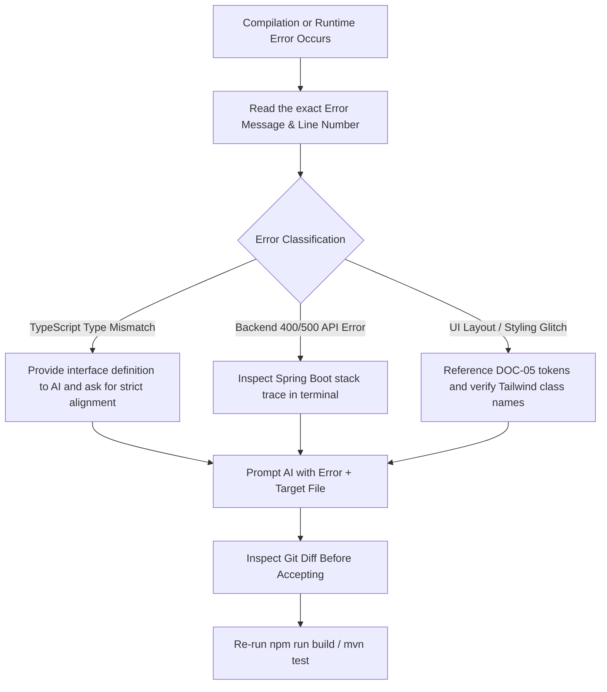

# WeddingOS — AI-Assisted Development Workflow & Engineering Standards

> **Document ID:** `DOC-06`  
> **Status:** Production Methodology Guide  
> **Audience:** Instructors, Students, Senior Software Engineers  
> **Philosophy:** Spec-Driven AI Development without Manual Coding

---

## 1. The Industry Paradigm Shift: Spec-Driven AI Engineering

In modern high-performance engineering teams, developers **do not write boilerplate line-by-line manually**. Instead, they act as **System Architects, Product Managers, and Quality Gatekeepers**. The AI is an ultra-fast junior engineer, but the human must supply the constraints, review the diffs, verify invariants, and validate tests.

```
┌─────────────────────────────────────────────────────────────────┐
│                    THE 5-STAGE AI ENGINEERING LOOP              │
│                                                                 │
│  1. CONTEXT     Provide PRD requirements, schemas, and design   │
│                 tokens before requesting code.                  │
│       │                                                         │
│       ▼                                                         │
│  2. PLAN        Instruct AI to produce an architectural plan    │
│                 first. Critique the plan before writing code.   │
│       │                                                         │
│       ▼                                                         │
│  3. GENERATE    Generate single, isolated vertical slices       │
│                 (e.g., one API endpoint or one UI component).   │
│       │                                                         │
│       ▼                                                         │
│  4. VERIFY      Run TypeScript compilation (`tsc -b`), linting, │
│                 and automated API tests. Inspect git diff.      │
│       │                                                         │
│       ▼                                                         │
│  5. COMMIT      Save progress to Git with semantic commit       │
│                 messages. Keep rollbacks painless.              │
└─────────────────────────────────────────────────────────────────┘
```

---

## 2. Core Rules for AI-Assisted Development

### Rule 1: Always Anchor in Existing Code & Specs
Never ask an AI to *"create a wedding management backend"* from scratch. That leads to hallucinated frameworks, wrong databases, and conflicting models.
**Always provide exact file paths:**
- Database models: [schema.sql](file:///d:/Build_With__AI_TapAcademy/WeddingOS/schema.sql)
- Frontend types: `apps/web/src/types/`
- API client: `apps/web/src/services/apiClient.ts`

### Rule 2: Plan Before Code
Never accept raw implementation on the first prompt for complex features. Always use a two-step prompting rhythm:
1. *"Review `schema.sql` and `docs/01-product-requirements.md` for FR-INV-01. Generate a 5-step technical implementation plan explaining what changes in the Controller, Repository, and React component."*
2. Once the plan is reviewed and approved: *"Proceed with Step 1 and 2 only. Show the exact diff."*

### Rule 3: Single Feature Isolation (Prevent Regressions)
When building or modifying a feature:
- Do NOT touch unrelated files.
- If modifying the Task page, do not accidentally refactor the Website Studio or the Invitation page.
- Limit the scope of each AI prompt to 1 or 2 files maximum.

### Rule 4: Zero Secret Exposure
- Never paste database passwords, Clerk secret keys, or Cloudinary API keys into AI prompts.
- Use environment variable placeholders (`${CLERK_SECRET_KEY}`).
- Regularly check `git status` and `git diff` to ensure `.env` files are in `.gitignore`.

### Rule 5: Trust, but Verify with Tools
AI-generated code is only a hypothesis until verified by three independent gates:
1. **Compilation Gate:** `npm run build` in `apps/web` (verifies TypeScript syntax and missing imports).
2. **Runtime Gate:** Inspect terminal server logs or browser devtools console for runtime errors.
3. **Behavioral Gate:** Perform the user action in the browser (e.g., click "Save", check that network payload matches `docs/04-api-design.md`).

---

## 3. How to Debug AI Errors & Code Failures

When code generated by AI fails, students should avoid frantic copy-pasting of error messages without reading them. Follow this systematic debugging protocol:



### The "Pinpoint Prompt" Template for Debugging:
> *"I encountered the following error when running `npm run build`:*  
> `[paste error message here]`  
> *Target file: `apps/web/src/pages/tasks/TasksPage.tsx` at line 142.*  
> *Do not rewrite the whole file. Explain why this type error happened, and provide only the replacement chunk to resolve it while preserving all existing comments and logic."*

---

## 4. Git Checkpointing Discipline

Instructors and students must commit code after every successful feature slice:
- `feat(tasks): implement drag-and-drop kanban task cards`
- `fix(invitations): prevent duplicate QR check-in scans`
- `refactor(website): inherit couple names from profile`

If an AI tool generates a hallucinated change that breaks the application, you can instantly revert without losing hours of work:
```bash
git restore <file>
# or discard unstaged changes:
git checkout .
```
