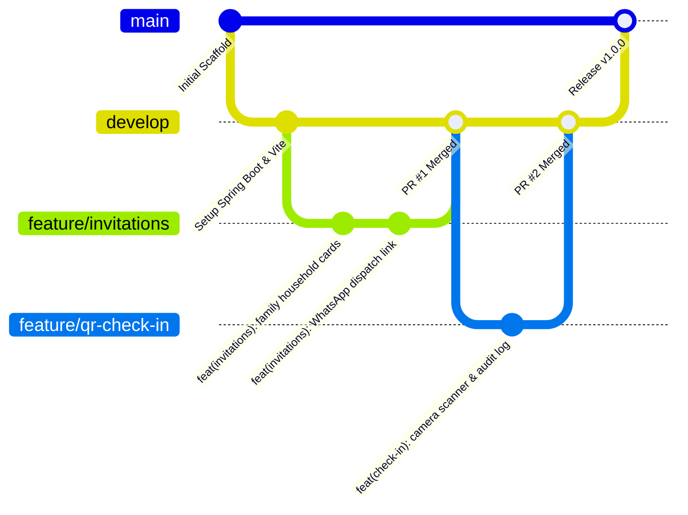

# WeddingOS — Git & Release Engineering Workflow

> **Document ID:** `DOC-09`  
> **Status:** Production Version Control Standard  
> **Audience:** Students, Instructors, Engineering Contributors

---

## 1. Why Version Control Matters in AI-Assisted Engineering

When building software with AI tools, **Git is not merely a backup tool — it is your safety net, checkpoint engine, and undo mechanism.** Because AI can generate hundreds of lines of code in seconds, developers must maintain strict control over what enters the codebase.

```
┌─────────────────────────────────────────────────────────────────┐
│                 THE GIT-AI CHECKPOINTING CYCLE                  │
│                                                                 │
│   1. CLEAN BASELINE     Run `git status` to ensure a clean      │
│                         working directory before prompting AI.  │
│          │                                                      │
│          ▼                                                      │
│   2. AI GENERATION      AI proposes code modifications across   │
│                         one or more files.                      │
│          │                                                      │
│          ▼                                                      │
│   3. DIFF INSPECTION    Execute `git diff` to review every      │
│                         added, changed, and deleted line.       │
│          │                                                      │
│          ▼                                                      │
│   4. BUILD GATE         Verify `npm run build` or `mvn test`.   │
│          │                                                      │
│          ▼                                                      │
│   5. ATOMIC COMMIT      Commit only the verified feature slice. │
└─────────────────────────────────────────────────────────────────┘
```

---

## 2. Branching Strategy

WeddingOS adopts a simplified **Trunk-Based / Feature-Branch Workflow** ideal for small teams and classroom workshops:

- **`main`**: Production-ready branch. Deployed automatically to Vercel (frontend) and Render (backend).
- **`develop`**: Integration branch where tested feature slices are unified.
- **`feature/<module-name>`**: Short-lived branches for individual modules (e.g., `feature/qr-check-in`, `feature/website-studio`).



---

## 3. Conventional Commits Standard

All commits must follow the **Conventional Commits Specification** to maintain a readable changelog:

$$\text{type}(\text{scope}): \text{short description in present tense}$$

### Common Commit Types:
- `feat`: A new user-facing feature (e.g., `feat(tasks): add priority tags and drag-and-drop`)
- `fix`: A bug fix (e.g., `fix(expenses): correct budget remaining calculation`)
- `docs`: Documentation changes (e.g., `docs(api): document Swagger UI endpoints`)
- `refactor`: Code changes that neither fix a bug nor add a feature (e.g., `refactor(website): inherit couple names from profile`)
- `style`: Formatting, missing semicolons, or Tailwind class cleanups
- `test`: Adding or updating automated test suites

---

## 4. How to Inspect & Reject AI Hallucinations

Before running `git add .`, **always inspect the diff:**
```bash
git diff
```

### Red Flags to Watch for in AI Code:
1. **Silent Deletions:** Did the AI accidentally delete unrelated helper functions or existing comments?
2. **Hardcoded Secrets:** Did the AI paste an API key or database password into source code?
3. **Ghost Dependencies:** Did the AI import a library that does not exist in `package.json` or `pom.xml`?
4. **Scope Creep:** Did the AI modify 10 files when you only asked it to fix one button?

### Fast Rollback Commands:
- **Discard changes in a single file:**
  ```bash
  git restore apps/web/src/pages/tasks/TasksPage.tsx
  ```
- **Discard all uncommitted changes across the entire repo:**
  ```bash
  git restore .
  git clean -fd
  ```
- **Undo the last commit while keeping your files staged:**
  ```bash
  git reset --soft HEAD~1
  ```
