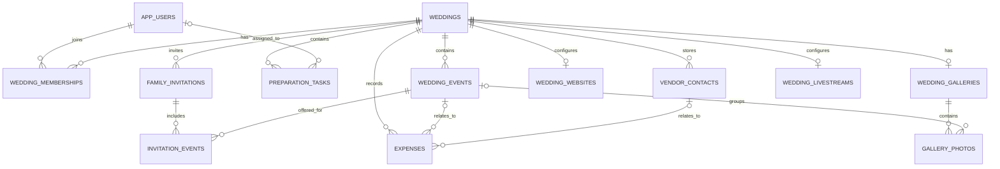

# WeddingOS — Database Design Document (DBDD)

**Document version:** 1.1  
**Status:** Updated with confirmed MVP decisions; proposed schema pending migration review  
**Database:** MySQL  
**Persistence approach:** Relational model with Spring Data JPA / Hibernate  
**Related documents:** `PRD.md`, `SYSTEM_DESIGN.md`, `API_DESIGN.md`

---

## 1. Purpose

This document defines the proposed relational database design for the WeddingOS MVP. It describes core entities, table structures, relationships, constraints, indexes, and data-integrity rules required to support the approved product scope.

The PRD is the source of truth for product behavior. The System Design document defines the wider architecture. This document defines how structured application data is stored in MySQL.

### Design principles

- Store structured wedding data in a relational database.
- Scope wedding-owned records to the correct wedding workspace.
- Represent invitees as family/invitation groups, not individual family-member records.
- Keep organizer identity separate from wedding membership and role assignment.
- Store image metadata and object keys in MySQL, not image binaries.
- Use database constraints alongside application-level validation.
- Use migrations to evolve the schema; do not modify production tables manually.
- Avoid adding fields and tables for features excluded from the MVP.

---

## 2. Scope and Assumptions

### Included

- Application user mapping to the external identity provider
- Wedding workspaces and organizer membership
- Events and preparation tasks
- Family-based invitations, event access, RSVP state, and family-level check-in
- Expenses and vendor contacts
- Wedding website configuration and publication state
- Gallery access configuration, photo metadata, and moderation
- External livestream configuration

### Explicitly excluded

- Guest accounts and individual guest profiles
- Parking, seating, accommodation, or transport coordination
- Vendor accounts, marketplace transactions, and payment processing
- Automated WhatsApp/SMS delivery
- Real-time notification infrastructure
- Photo binary storage inside MySQL

### Assumptions to validate

1. A user may own or participate in only one wedding workspace during the MVP. This is a product constraint, not a reason to make membership structurally inflexible.
2. A wedding may have multiple events and multiple organizers.
3. A family invitation may be associated with one or more events.
4. A family's RSVP applies to its invitation group; attendee count cannot exceed the configured maximum.
5. Family invitations use their own high-entropy token. The gallery uses one stable high-entropy link for both viewing and uploading; upload operations must still be authorized and rate-limited server-side.
6. Uploaded photos are private and remain pending moderation until approved.
7. The selected identity provider is Clerk, but the application maintains its own internal user record and authorization model.
8. The final object-storage provider is not yet locked. Store provider-neutral object keys and metadata.
9. The schema uses `BIGINT` identity keys for internal records unless a table is better served by a dedicated public token. External IDs and guest-facing tokens are not database primary keys.
10. The SQL types target a modern MySQL release using InnoDB and `utf8mb4`. Confirm the exact managed MySQL version before writing migrations.

---

## 3. Naming and Data Conventions

- Table names: lowercase `snake_case`, plural nouns where practical.
- Column names: lowercase `snake_case`.
- Internal primary keys: `BIGINT` auto-increment, except where an external provider ID or token design requires a separate unique column.
- Foreign keys: `<referenced_entity>_id`.
- Timestamps: store in UTC using `DATETIME(3)` and convert at the application boundary. Keep wedding/event local-time interpretation explicit in application logic.
- Currency: store as `DECIMAL(12,2)` with currency code `CHAR(3)`; default wedding expenses to INR (`INR`) for the initial target market.
- Boolean values: `BOOLEAN` / `TINYINT(1)`.
- Text encoding: `utf8mb4`.
- Soft delete: do not add a generic soft-delete field to every table by default. Define deletion behavior per entity and preserve records only where the product requires it.
- Public slugs and token digests: use dedicated columns with unique indexes.
- Avoid storing raw invitation/gallery tokens when storing a cryptographic digest is practical.
- All tables should use InnoDB.

---

## 4. Entity Relationship Overview

RSVP state is stored directly on `family_invitations`; no separate RSVP-history table is used in the MVP. Vendors are linked to expenses where applicable, but there is no vendor-to-event join table in the MVP.

---

## 5. Table Definitions

## 5.1 `app_users`

Maps an application user to the external identity provider. Clerk remains responsible for sign-in credentials; WeddingOS must not store Clerk passwords.

| Column | Type | Constraints | Description |
|---|---|---|---|
| `id` | `BIGINT` | PK, auto-increment | Internal user ID |
| `clerk_user_id` | `VARCHAR(191)` | NOT NULL, UNIQUE | Stable user identifier from Clerk |
| `email` | `VARCHAR(254)` | NULL | Current email address, if available |
| `display_name` | `VARCHAR(120)` | NULL | User-facing name |
| `created_at` | `DATETIME(3)` | NOT NULL | Creation timestamp |
| `updated_at` | `DATETIME(3)` | NOT NULL | Last update timestamp |

**Notes**
- The Clerk user ID is the identity key for mapping verified tokens to the internal user.
- Do not use email as the sole identity key; email may change.
- Do not store passwords or authentication secrets managed by Clerk.
- Decide whether email is required only after confirming the account flows in the PRD and Clerk configuration.

## 5.2 `weddings`

Stores the core workspace and wedding details.

| Column | Type | Constraints | Description |
|---|---|---|---|
| `id` | `BIGINT` | PK, auto-increment | Internal wedding ID |
| `created_by_user_id` | `BIGINT` | NOT NULL, FK → `app_users.id` | User who created the workspace |
| `title` | `VARCHAR(160)` | NULL | Optional wedding title |
| `bride_name` | `VARCHAR(120)` | NOT NULL | Bride's name |
| `groom_name` | `VARCHAR(120)` | NOT NULL | Groom's name |
| `wedding_date` | `DATE` | NOT NULL | Main wedding date |
| `location_name` | `VARCHAR(180)` | NOT NULL | City / venue summary |
| `description` | `VARCHAR(1000)` | NULL | Optional welcome/description text |
| `cover_image_object_key` | `VARCHAR(512)` | NULL | Storage reference; publication rules control access |
| `created_at` | `DATETIME(3)` | NOT NULL | Creation timestamp |
| `updated_at` | `DATETIME(3)` | NOT NULL | Last update timestamp |

**Constraints and indexes**
- Index `created_by_user_id`.
- Validate names, date, and location at the application layer.
- Do not assume a cover image is public solely because the key exists.
- The MVP one-workspace-per-user rule should be enforced in the application and, if the product confirms that a user can create only one workspace regardless of membership, by a suitable unique constraint. The PRD's phrasing may mean one created/owned workspace rather than one membership total, so clarify before enforcing a global uniqueness rule.

## 5.3 `wedding_memberships`

Connects internal users to wedding workspaces and stores role and module permissions.

| Column | Type | Constraints | Description |
|---|---|---|---|
| `id` | `BIGINT` | PK, auto-increment | Membership ID |
| `wedding_id` | `BIGINT` | NOT NULL, FK → `weddings.id` | Wedding workspace |
| `user_id` | `BIGINT` | NOT NULL, FK → `app_users.id` | Organizer identity |
| `role` | `VARCHAR(20)` | NOT NULL | `ADMIN` or `ORGANIZER` |
| `module_permissions_json` | `JSON` | NULL | Optional module-level permission overrides |
| `invited_by_user_id` | `BIGINT` | NULL, FK → `app_users.id` | Organizer who invited the member |
| `joined_at` | `DATETIME(3)` | NULL | Time the invitation was accepted |
| `created_at` | `DATETIME(3)` | NOT NULL | Record creation |
| `updated_at` | `DATETIME(3)` | NOT NULL | Last update |

**Constraints and indexes**
- Unique `(wedding_id, user_id)` to prevent duplicate membership.
- Index `(user_id, role)` for membership lookup.
- Validate `role` against the approved values in application logic and, if compatible with the selected MySQL version, a database `CHECK`.
- Treat module permissions as a constrained, versioned JSON structure; never interpret arbitrary client-supplied permission JSON as trusted.
- The last-Admin invariant must be enforced transactionally in the service layer; a simple foreign key cannot enforce it.

### Pending organizer invitations

Pending organizer invitations are stored in `organizer_invitations` before the invitee signs up or signs in. Do not overload `wedding_memberships` with a placeholder user ID.

## 5.4 `wedding_events`

Stores wedding functions and ceremonies.

| Column | Type | Constraints | Description |
|---|---|---|---|
| `id` | `BIGINT` | PK, auto-increment | Event ID |
| `wedding_id` | `BIGINT` | NOT NULL, FK → `weddings.id` | Owning wedding |
| `name` | `VARCHAR(120)` | NOT NULL | Event name |
| `event_date` | `DATE` | NOT NULL | Event date |
| `start_time` | `TIME` | NULL | Local start time |
| `end_time` | `TIME` | NULL | Local end time |
| `venue_name` | `VARCHAR(180)` | NULL | Venue name |
| `address` | `VARCHAR(500)` | NULL | Venue address |
| `description` | `VARCHAR(1000)` | NULL | Optional event details |
| `dress_code` | `VARCHAR(160)` | NULL | Optional dress code |
| `map_url` | `VARCHAR(2048)` | NULL | Optional validated map link |
| `cover_image_object_key` | `VARCHAR(512)` | NULL | Optional storage reference |
| `sort_order` | `INT` | NOT NULL DEFAULT 0 | Optional stable display order |
| `created_at` | `DATETIME(3)` | NOT NULL | Creation timestamp |
| `updated_at` | `DATETIME(3)` | NOT NULL | Last update timestamp |

**Indexes**
- `(wedding_id, event_date, start_time)`
- `(wedding_id, name)`

Events are displayed chronologically. Store local event date/time as entered for the wedding location; do not silently reinterpret them as UTC timestamps.

## 5.5 `preparation_tasks`

Stores wedding-preparation tasks.

| Column | Type | Constraints | Description |
|---|---|---|---|
| `id` | `BIGINT` | PK, auto-increment | Task ID |
| `wedding_id` | `BIGINT` | NOT NULL, FK → `weddings.id` | Owning wedding |
| `title` | `VARCHAR(180)` | NOT NULL | Task title |
| `description` | `VARCHAR(1000)` | NULL | Task details |
| `assigned_to_user_id` | `BIGINT` | NULL, FK → `app_users.id` | Assigned organizer |
| `related_event_id` | `BIGINT` | NULL, FK → `wedding_events.id` | Optional related event |
| `due_date` | `DATE` | NULL | Due date |
| `priority` | `VARCHAR(10)` | NOT NULL DEFAULT 'MEDIUM' | `LOW`, `MEDIUM`, `HIGH` |
| `status` | `VARCHAR(20)` | NOT NULL DEFAULT 'TODO' | `TODO`, `IN_PROGRESS`, `COMPLETED` |
| `created_by_user_id` | `BIGINT` | NOT NULL, FK → `app_users.id` | Creator |
| `created_at` | `DATETIME(3)` | NOT NULL | Creation timestamp |
| `updated_at` | `DATETIME(3)` | NOT NULL | Last update timestamp |

**Indexes**
- `(wedding_id, status, due_date)`
- `(assigned_to_user_id, status)`
- `(related_event_id)`

When an assignee or related event is set, it must belong to the same wedding. Enforce this in the service layer or through a reviewed composite-key strategy.

## 5.6 `family_invitations`

One record represents one family or invitation group, not individual members.

| Column | Type | Constraints | Description |
|---|---|---|---|
| `id` | `BIGINT` | PK, auto-increment | Invitation record ID |
| `wedding_id` | `BIGINT` | NOT NULL, FK → `weddings.id` | Owning wedding |
| `display_name` | `VARCHAR(180)` | NOT NULL | Family / invitation label |
| `primary_contact_name` | `VARCHAR(120)` | NULL | Optional contact name |
| `phone_number` | `VARCHAR(32)` | NULL | Optional phone |
| `email` | `VARCHAR(254)` | NULL | Optional email |
| `max_attendees` | `SMALLINT UNSIGNED` | NOT NULL | Maximum permitted attendees |
| `rsvp_status` | `VARCHAR(20)` | NOT NULL DEFAULT 'PENDING' | `PENDING`, `ATTENDING`, `NOT_ATTENDING` |
| `attendee_count` | `SMALLINT UNSIGNED` | NOT NULL DEFAULT 0 | Confirmed attendees |
| `organizer_notes` | `VARCHAR(2000)` | NULL | Private notes |
| `invitation_token_hash` | `BINARY(32)` | NOT NULL, UNIQUE | SHA-256 digest of high-entropy token |
| `invitation_token_created_at` | `DATETIME(3)` | NOT NULL | Token creation time |
| `invitation_token_revoked_at` | `DATETIME(3)` | NULL | Optional revocation timestamp |
| `checked_in_at` | `DATETIME(3)` | NULL | Family-level check-in time |
| `checked_in_by_user_id` | `BIGINT` | NULL, FK → `app_users.id` | Organizer who checked in |
| `created_at` | `DATETIME(3)` | NOT NULL | Creation timestamp |
| `updated_at` | `DATETIME(3)` | NOT NULL | Last update timestamp |

**Constraints and indexes**
- Index `(wedding_id, rsvp_status)`.
- Index `(wedding_id, display_name)`.
- Validate `max_attendees >= 1`.
- Validate `0 <= attendee_count <= max_attendees`.
- If RSVP status is `NOT_ATTENDING` or `PENDING`, attendee count should be zero.
- Use a cryptographically secure random token with sufficient entropy; store only its digest.
- A revoked token must not be accepted.
- `checked_in_at` and `checked_in_by_user_id` should be set together or both remain null.
- Ensure the check-in organizer belongs to the same wedding and has permission to check in.

A family can update its RSVP through the same valid invitation link. Each submission overwrites the current `rsvp_status` and `attendee_count` on this row. The MVP keeps only the latest RSVP state; it does not store RSVP change history.

## 5.7 `invitation_events`

Join table mapping a family invitation to the events it is allowed to attend.

| Column | Type | Constraints | Description |
|---|---|---|---|
| `family_invitation_id` | `BIGINT` | PK part, FK → `family_invitations.id` | Invitation group |
| `wedding_event_id` | `BIGINT` | PK part, FK → `wedding_events.id` | Allowed event |
| `created_at` | `DATETIME(3)` | NOT NULL | Association creation time |

Composite primary key `(family_invitation_id, wedding_event_id)` prevents duplicate associations. The invitation and event must belong to the same wedding; enforce this in application logic or use a reviewed schema strategy.

## 5.8 `expenses`

Stores recorded wedding expenses. This is not a payment-processing or budget-management table.

| Column | Type | Constraints | Description |
|---|---|---|---|
| `id` | `BIGINT` | PK, auto-increment | Expense ID |
| `wedding_id` | `BIGINT` | NOT NULL, FK → `weddings.id` | Owning wedding |
| `title` | `VARCHAR(180)` | NOT NULL | Expense description |
| `amount` | `DECIMAL(12,2)` | NOT NULL | Amount recorded |
| `currency_code` | `CHAR(3)` | NOT NULL DEFAULT 'INR' | Currency code |
| `expense_date` | `DATE` | NOT NULL | Date of expense |
| `category` | `VARCHAR(40)` | NOT NULL | Expense category |
| `related_event_id` | `BIGINT` | NULL, FK → `wedding_events.id` | Optional related event |
| `vendor_contact_id` | `BIGINT` | NULL, FK → `vendor_contacts.id` | Optional related vendor |
| `notes` | `VARCHAR(2000)` | NULL | Optional notes |
| `created_by_user_id` | `BIGINT` | NOT NULL, FK → `app_users.id` | Creator |
| `created_at` | `DATETIME(3)` | NOT NULL | Creation timestamp |
| `updated_at` | `DATETIME(3)` | NOT NULL | Last update timestamp |

**Indexes**
- `(wedding_id, expense_date)`
- `(wedding_id, category)`
- `(vendor_contact_id)`

If event or vendor references are provided, they must belong to the same wedding. Category values should be constrained to supported categories or an explicitly allowed `OTHER` value. Store currency explicitly even if the MVP initially displays INR.

## 5.9 `vendor_contacts`

Stores vendor contact information; vendors do not have WeddingOS accounts.

| Column | Type | Constraints | Description |
|---|---|---|---|
| `id` | `BIGINT` | PK, auto-increment | Vendor contact ID |
| `wedding_id` | `BIGINT` | NOT NULL, FK → `weddings.id` | Owning wedding |
| `name` | `VARCHAR(180)` | NOT NULL | Vendor name |
| `category` | `VARCHAR(50)` | NOT NULL | Vendor category |
| `contact_person` | `VARCHAR(120)` | NULL | Contact person |
| `phone_number` | `VARCHAR(32)` | NULL | Phone |
| `email` | `VARCHAR(254)` | NULL | Email |
| `address` | `VARCHAR(500)` | NULL | Address |
| `website_url` | `VARCHAR(2048)` | NULL | Optional validated website URL |
| `agreed_cost` | `DECIMAL(12,2)` | NULL | Optional agreed cost |
| `currency_code` | `CHAR(3)` | NOT NULL DEFAULT 'INR' | Currency code |
| `notes` | `VARCHAR(2000)` | NULL | Optional notes |
| `created_by_user_id` | `BIGINT` | NOT NULL, FK → `app_users.id` | Creator |
| `created_at` | `DATETIME(3)` | NOT NULL | Creation timestamp |
| `updated_at` | `DATETIME(3)` | NOT NULL | Last update timestamp |

**Indexes**
- `(wedding_id, name)`
- `(wedding_id, category)`

A vendor may exist without an expense, and an expense may exist without a vendor. For MVP simplicity, vendors are not directly associated with events. If an event-specific vendor association is needed later, add it in a future schema version.

## 5.10 `wedding_websites`

One configuration per wedding for the generated public-facing wedding website.

| Column | Type | Constraints | Description |
|---|---|---|---|
| `id` | `BIGINT` | PK, auto-increment | Website configuration ID |
| `wedding_id` | `BIGINT` | NOT NULL, UNIQUE, FK → `weddings.id` | Owning wedding |
| `slug` | `VARCHAR(100)` | NOT NULL, UNIQUE | Public path slug |
| `theme_key` | `VARCHAR(40)` | NOT NULL | `CLASSIC_INDIAN`, `MINIMAL_ELEGANT`, `MODERN_CELEBRATION` |
| `welcome_message` | `VARCHAR(2000)` | NULL | Public welcome text |
| `is_published` | `BOOLEAN` | NOT NULL DEFAULT FALSE | Publication state |
| `published_at` | `DATETIME(3)` | NULL | Most recent publication time |
| `created_at` | `DATETIME(3)` | NOT NULL | Creation timestamp |
| `updated_at` | `DATETIME(3)` | NOT NULL | Last update timestamp |

**Constraints and behavior**
- Normalize and uniquely constrain `slug`.
- Only published website content is available through public website endpoints.
- Unpublishing must stop public content from being served, subject to configured cache expiry.
- Theme keys are a closed set of three values for the MVP.
- Do not duplicate wedding names/date/location here unless a future publishing snapshot requires it.

## 5.11 `wedding_galleries`

One gallery configuration per wedding. One stable guest-facing link supports both viewing approved photos and uploading new photos.

| Column | Type | Constraints | Description |
|---|---|---|---|
| `id` | `BIGINT` | PK, auto-increment | Gallery ID |
| `wedding_id` | `BIGINT` | NOT NULL, UNIQUE, FK → `weddings.id` | Owning wedding |
| `gallery_token_hash` | `BINARY(32)` | NOT NULL, UNIQUE | Digest of the single stable gallery link token used for viewing and upload entry |

| `is_enabled` | `BOOLEAN` | NOT NULL DEFAULT TRUE | Gallery enabled state |
| `uploads_enabled` | `BOOLEAN` | NOT NULL DEFAULT TRUE | Guest upload toggle |
| `token_created_at` | `DATETIME(3)` | NOT NULL | Token creation timestamp |
| `token_revoked_at` | `DATETIME(3)` | NULL | Optional revocation timestamp |
| `created_at` | `DATETIME(3)` | NOT NULL | Creation timestamp |
| `updated_at` | `DATETIME(3)` | NOT NULL | Last update timestamp |

The same stable link opens both gallery viewing and upload entry. The server must still apply narrower operation-specific checks: only approved photos are visible to guests, uploads are accepted only when `uploads_enabled` is true, and upload endpoints must enforce file validation and rate limits. The raw token must never grant organizer access. Revoking the gallery token invalidates the stable link for both viewing and upload.

## 5.12 `gallery_photos`

Stores photo metadata and moderation state. The binary is stored in object storage.

| Column | Type | Constraints | Description |
|---|---|---|---|
| `id` | `BIGINT` | PK, auto-increment | Photo record ID |
| `gallery_id` | `BIGINT` | NOT NULL, FK → `wedding_galleries.id` | Parent gallery |
| `wedding_event_id` | `BIGINT` | NULL, FK → `wedding_events.id` | Optional event grouping |
| `object_key` | `VARCHAR(512)` | NOT NULL, UNIQUE | Provider-neutral storage object key |
| `original_filename` | `VARCHAR(255)` | NULL | Sanitized display metadata only |
| `content_type` | `VARCHAR(100)` | NOT NULL | Verified media type |
| `size_bytes` | `BIGINT UNSIGNED` | NOT NULL | Stored file size |
| `uploaded_by_user_id` | `BIGINT` | NULL, FK → `app_users.id` | Organizer uploader, if authenticated |
| `uploader_label` | `VARCHAR(120)` | NULL | Optional guest-provided label |
| `status` | `VARCHAR(20)` | NOT NULL DEFAULT 'PENDING' | `PENDING`, `APPROVED`, `REJECTED`, `REMOVED` |
| `moderated_by_user_id` | `BIGINT` | NULL, FK → `app_users.id` | Organizer who reviewed it |
| `moderated_at` | `DATETIME(3)` | NULL | Review time |
| `moderation_note` | `VARCHAR(1000)` | NULL | Optional internal note |
| `created_at` | `DATETIME(3)` | NOT NULL | Upload record creation |
| `updated_at` | `DATETIME(3)` | NOT NULL | Last update |

**Indexes**
- `(gallery_id, status, created_at)`
- `(wedding_event_id, status)`
- `(moderated_by_user_id)`

Only `APPROVED` photos may be returned to gallery visitors. Pending, rejected, and removed photos are organizer-only. Event association must belong to the same wedding as the gallery. Enforce file limits and permitted formats before accepting an upload. On removal, delete or schedule deletion of the object according to the retention policy. Derive constrained access URLs when needed rather than storing a permanent public URL as the only reference.

## 5.13 `wedding_livestreams`

Stores the optional external livestream configuration.

| Column | Type | Constraints | Description |
|---|---|---|---|
| `id` | `BIGINT` | PK, auto-increment | Livestream configuration ID |
| `wedding_id` | `BIGINT` | NOT NULL, UNIQUE, FK → `weddings.id` | Owning wedding |
| `provider` | `VARCHAR(30)` | NOT NULL DEFAULT 'YOUTUBE' | External provider |
| `stream_url` | `VARCHAR(2048)` | NOT NULL | Validated external URL |
| `is_enabled` | `BOOLEAN` | NOT NULL DEFAULT TRUE | Whether it is shown |
| `created_at` | `DATETIME(3)` | NOT NULL | Creation timestamp |
| `updated_at` | `DATETIME(3)` | NOT NULL | Last update timestamp |

Validate the URL against allowed provider formats. Do not accept arbitrary embed HTML from users.

---

## 6. Organizer Invitation Table

A pending invitation is created when an Admin invites an organizer, even if the invitee has not signed up or signed in yet. Use a separate table rather than a fake membership. This table is part of the MVP schema.

### `organizer_invitations`

| Column | Type | Constraints | Description |
|---|---|---|---|
| `id` | `BIGINT` | PK, auto-increment | Invitation ID |
| `wedding_id` | `BIGINT` | NOT NULL, FK → `weddings.id` | Target wedding |
| `target_email_normalized` | `VARCHAR(254)` | NOT NULL | Intended invitee |
| `role` | `VARCHAR(20)` | NOT NULL DEFAULT 'ORGANIZER' | Intended role |
| `module_permissions_json` | `JSON` | NULL | Optional initial module access |
| `token_hash` | `BINARY(32)` | NOT NULL, UNIQUE | Digest of high-entropy invite token |
| `invited_by_user_id` | `BIGINT` | NOT NULL, FK → `app_users.id` | Admin who invited |
| `status` | `VARCHAR(20)` | NOT NULL DEFAULT 'PENDING' | `PENDING`, `ACCEPTED`, `REVOKED`, `EXPIRED` |
| `expires_at` | `DATETIME(3)` | NOT NULL | Expiration |
| `accepted_by_user_id` | `BIGINT` | NULL, FK → `app_users.id` | User who accepted |
| `accepted_at` | `DATETIME(3)` | NULL | Acceptance time |
| `created_at` | `DATETIME(3)` | NOT NULL | Creation timestamp |

Suggested indexes: `(wedding_id, status)`, `(target_email_normalized, status)`, and unique `token_hash`.

Acceptance must validate token status and expiry, verify the authenticated invitee matches the normalized intended email according to the chosen account-verification flow, create exactly one membership, and mark the invitation accepted transactionally. Pending invitations can be revoked or expire without creating a membership.

---

## 7. Relationship and Deletion Policy

Use restrictive deletion behavior for referenced business records unless the product explicitly defines cascading deletion.

| Parent / record | Suggested behavior |
|---|---|
| User | Do not cascade-delete wedding data merely because an identity is removed; define account deletion separately |
| Wedding | Require an explicit, authorized workflow and reviewed retention policy |
| Wedding event | Warn if referenced by invitations, tasks, expenses, or photos; detach or block deletion according to product rules |
| Family invitation | Revoking its link should not require deleting the record |
| Vendor contact | If expenses reference it, preserve the expense and either block deletion or null the optional reference after confirmation |
| Photo | Remove access immediately; delete the object or queue cleanup under the retention policy |
| Gallery | Disable guest access without necessarily deleting photo records |
| Website | Unpublish to remove public visibility; deletion is a separate operation |

Avoid broad `ON DELETE CASCADE` rules that could unexpectedly delete wedding records. Review every foreign-key deletion rule in migrations.

---

## 8. Data Integrity and Business Rules

These rules require application-level enforcement even where database constraints are also present.

1. A user cannot access records belonging to an unrelated wedding.
2. A family invitation, event, task, expense, vendor, gallery, and photo association must remain within the same wedding.
3. A family invitation has a maximum attendee count of at least one.
4. RSVP attendee count cannot exceed `max_attendees`.
5. If RSVP status is `NOT_ATTENDING` or `PENDING`, the confirmed attendee count should be zero.
6. An invitation token must be valid and not revoked before guest RSVP access is granted.
7. Only an authorized Admin may manage organizer membership and roles.
8. The last remaining Admin cannot be removed or demoted.
9. Only approved photos are visible to gallery visitors.
10. Only authorized organizers may moderate photos or mark a family invitation as checked in.
11. A public wedding website returns content only while published.
12. A gallery token grants gallery-specific access only; it does not grant organizer access.
13. A photo's event, if present, must belong to the same wedding as its gallery.
14. An expense's optional event/vendor references must belong to the same wedding as the expense.
15. An assigned task user and related event must belong to the same wedding as the task.
16. Repeated RSVP submissions update the existing state rather than creating duplicate invitations.
17. Family check-in is once per wedding invitation, not per event. Repeated check-in attempts are handled safely and surfaced as an already-checked-in state.
18. A gallery has one stable guest-facing token for viewing and upload entry; upload permission is still controlled by `uploads_enabled` and server-side validation.
18. External URLs are validated and restricted to supported protocols/providers where required.

---

## 9. Indexing Strategy

Create indexes for actual access patterns, not every column.

| Table | Proposed index | Purpose |
|---|---|---|
| `app_users` | Unique `(clerk_user_id)` | Resolve internal user from authenticated identity |
| `wedding_memberships` | Unique `(wedding_id, user_id)` | Prevent duplicate membership |
| `wedding_memberships` | `(user_id, role)` | Find user memberships |
| `wedding_events` | `(wedding_id, event_date, start_time)` | Chronological event list |
| `preparation_tasks` | `(wedding_id, status, due_date)` | Task lists and progress |
| `preparation_tasks` | `(assigned_to_user_id, status)` | Assigned task views |
| `family_invitations` | Unique `(invitation_token_hash)` | Resolve guest invitation link |
| `family_invitations` | `(wedding_id, rsvp_status)` | RSVP summary |
| `family_invitations` | `(wedding_id, display_name)` | Guest group search/list |
| `invitation_events` | Composite PK | Unique invitation/event association |
| `expenses` | `(wedding_id, expense_date)` | Expense list and totals by period |
| `expenses` | `(wedding_id, category)` | Category filtering |
| `vendor_contacts` | `(wedding_id, name)` | Vendor search/list |
| `wedding_websites` | Unique `(slug)` | Public website lookup |
| `wedding_galleries` | Unique `gallery_token_hash` | Resolve the stable gallery link |
| `gallery_photos` | `(gallery_id, status, created_at)` | Gallery and moderation lists |
| `organizer_invitations` | `(wedding_id, status)` | Pending organizer invitations |

Verify index names and query plans against final migrations and actual query patterns. Avoid redundant indexes that duplicate primary or unique indexes.

---

## 10. Migration and Versioning Strategy

Use versioned SQL migrations through the migration tool selected for the project (Flyway is recommended but not yet finalized).

Recommended practices:
- Store migration scripts in the backend resource migration directory.
- Never edit an already-applied migration in a shared or deployed environment; add a new migration.
- Review every migration for data loss, locking, defaults, and rollback/recovery needs.
- Use representative development data to validate schema changes.
- Avoid automatic production schema generation from ORM entities.
- Keep entity mappings and migration scripts consistent.
- Document any data backfill or one-time migration step.

A reasonable initial sequence is:

1. Identity and wedding workspace: `app_users`, `weddings`, `wedding_memberships`
2. Events and tasks
3. Family invitations and invitation/event associations
4. Expenses and vendor contacts
5. Website and livestream configuration
6. Gallery configuration and photo metadata
7. Organizer invitations

Precise migration numbering and filenames should be set when the repository is initialized.

---

## 11. Privacy, Retention, and Operational Considerations

- Avoid collecting guest details that are not needed for invitations.
- Keep organizer notes and contact information private to authorized workspace members.
- Do not store passwords managed by Clerk.
- Never store raw guest tokens in logs.
- Store photo object keys and access metadata, not public permanent URLs.
- Define account deletion, wedding deletion, gallery disablement, and photo retention before production.
- Configure database backups and periodically test restoration.
- Establish cleanup for orphaned storage objects and expired pending uploads.
- Keep personal data out of sample fixtures and public repositories.

---

## 12. Seed Data and Development Fixtures

Development seed data should be synthetic and must never include real wedding guest contact information.

Suggested seed records:
- One test user mapped to a development Clerk identity
- One sample wedding
- Two organizer memberships with different roles
- A small set of events
- A few tasks in each supported status
- Family invitations covering Pending, Attending, and Not Attending
- Example expenses and vendor contacts
- Website fixtures for published and unpublished states
- Gallery photos covering Pending, Approved, Rejected, and Removed states

Do not put production Clerk IDs, storage credentials, tokens, or real guest data into seed scripts.

---

## 13. Remaining Open Questions Before Production Migrations

The following decisions are confirmed for the MVP and are no longer open:
- Organizer invitations are persisted before signup in `organizer_invitations`.
- Only the latest family RSVP is stored directly on `family_invitations`.
- One stable gallery link supports both viewing and upload entry.
- Family check-in is recorded once for the whole wedding invitation.
- Vendors are not directly associated with events; `vendor_contact_events` is excluded.

Resolve the remaining items before finalizing SQL migrations:

1. **One wedding per user:** Does the PRD mean one workspace created by a user, or one workspace total that the user may belong to? Avoid enforcing a global membership restriction until this is clarified.
2. **Gallery upload policy:** Confirm maximum file size, allowed formats, per-link rate limits, and retention policy.
3. **Expense rules:** Confirm whether zero-value expenses are valid and whether negative amounts are ever used for refunds. Current design assumes non-negative amounts.
4. **Cover image access:** Confirm whether wedding/event cover images are intended to be publicly retrievable when the wedding website is published.
5. **Deletion and retention:** Define wedding deletion, gallery deletion, and photo retention before production.

These remaining questions do not block the conceptual schema, but should be resolved before creating production migrations.

---

## 14. Readiness Checklist

The DBDD is ready to become executable migrations when:

- Table names and relationships have been reviewed against the PRD.
- Open product decisions that affect schema are resolved.
- Cross-wedding integrity rules have a documented enforcement strategy.
- Token generation, hashing, revocation, and lookup behavior are specified.
- Gallery moderation and object-storage lifecycle are agreed.
- Foreign-key deletion behavior has been reviewed.
- Indexes are matched to expected queries.
- Migration tooling and supported MySQL version are confirmed.
- Entity mappings and migration scripts can be tested together.

---

## 15. Document Governance

- `PRD.md` defines product behavior and scope.
- `SYSTEM_DESIGN.md` defines component architecture and cross-cutting technical behavior.
- `DBDD.md` defines relational storage, constraints, indexes, and migration strategy.
- `API_DESIGN.md` defines endpoint contracts and data-transfer formats.

Any schema change that alters user-visible behavior must be reviewed against the PRD. Any change that affects API payloads must be reflected in `API_DESIGN.md`.

---

**End of document**
