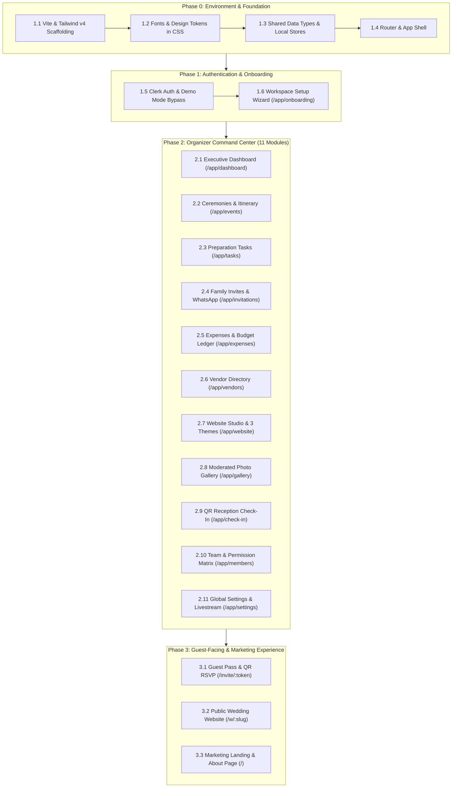

# WeddingOS — Frontend Engineering Master Playbook & Student Curriculum
> **The Deterministic, Step-by-Step Production Guide: From Architectural Specs to the Complete Indian Wedding Operating System**  
> *Author: Engineering Curriculum Lead*  
> *Target Framework: Vite + React 19 + TypeScript + TailwindCSS v4 + Antigravity AI*

---

## 0. Instructor's Foreword: How to Teach with this Playbook

When presenting this project to your students or co-founders, emphasize the **Senior Engineering Mindset**:
> *"We do not ask AI to magically 'make a wedding website'. We provide the PRD, enforce the design system tokens, scaffold shared data stores, and build module-by-module with deterministic acceptance criteria. This is how high-velocity software engineering teams ship enterprise-grade software."*

### Why this Playbook Guarantees the Exact Same Website:
Generative AI can introduce minor aesthetic variations if given vague instructions. This playbook eliminates ambiguity by giving:
1. **Exact File Paths** for every component and store.
2. **Explicit TypeScript Interfaces** so data models never conflict across routes.
3. **Pre-configured Seed Data** (e.g. Haldi, Sangeet, Pheras; Singhania, Verma, Chowdhury families; INR budget figures) so screens are immediately populated with realistic royal wedding data.
4. **Strict Typography Invariants**:
   - `font-cormorant`: Exclusively for editorial headings and display titles.
   - `font-sans font-bold tabular-nums`: For **all numbers, monetary figures (₹), dates, and headcounts** across both Events and Expenses.
5. **Exact Color Tokens**: Ivory `#faf9f6`, Deep Wine `#4b030e`, Royal Burgundy `#6f0617`, Champagne Gold `#e6bd81`, Antique Gold `#b88444`.

---

## 1. Curriculum Roadmap & Chronological Execution Order



---

## 2. Phase 0 — Environment, Tokens & Foundation Setup

### Step 2.1: Project Scaffolding & Dependencies
Run the following terminal commands in the repository root:

```bash
# Initialize Vite React + TypeScript project
npm create vite@latest apps/web -- --template react-ts
cd apps/web

# Install styling and icons
npm install @tailwindcss/vite tailwindcss@^4.0.0 lucide-react

# Install routing and authentication
npm install react-router-dom @clerk/clerk-react

# Install QR code generator, live camera scanner & celebration FX
npm install qrcode @types/qrcode
npm install html5-qrcode
npm install canvas-confetti @types/canvas-confetti

# Install developer tools
npm install -D oxlint @types/node
```

### Step 2.2: Network-Exposed Vite Configuration
Replace `apps/web/vite.config.ts`:
```ts
import { defineConfig } from 'vite'
import react from '@vitejs/plugin-react'
import tailwindcss from '@tailwindcss/vite'

export default defineConfig({
  plugins: [react(), tailwindcss()],
  server: {
    host: true, // Enables testing on phones via Wi-Fi IP
    port: 5173,
  },
})
```

### Step 2.3: Fonts in `apps/web/index.html`
Add Google Fonts (`Cormorant Garamond` and `Inter`) to the `<head>` of `apps/web/index.html`:
```html
<!doctype html>
<html lang="en">
  <head>
    <meta charset="UTF-8" />
    <link rel="icon" type="image/png" href="/favicon.png" />
    <meta name="viewport" content="width=device-width, initial-scale=1.0" />
    <title>WeddingOS — Wedding Planning, Organized in One Place</title>
    <link rel="preconnect" href="https://fonts.googleapis.com" />
    <link rel="preconnect" href="https://fonts.gstatic.com" crossorigin />
    <link
      href="https://fonts.googleapis.com/css2?family=Cormorant+Garamond:ital,wght@0,400;0,500;0,600;0,700;1,400;1,600;1,700&family=Inter:wght@300;400;500;600;700&display=swap"
      rel="stylesheet"
    />
  </head>
  <body>
    <div id="root"></div>
    <script type="module" src="/src/main.tsx"></script>
  </body>
</html>
```

### Step 2.4: Design System Tokens in `apps/web/src/index.css`
Replace `apps/web/src/index.css`:
```css
@import "tailwindcss";

@theme {
  --color-ivory: #faf9f6;
  --color-wine: #4b030e;
  --color-deep-wine: #2f0209;
  --color-burgundy: #6f0617;
  --color-burgundy-hover: #580412;
  --color-burgundy-primary: #6f0617;
  --color-burgundy-accent: #a5172a;
  --color-champagne: #e6bd81;
  --color-champagne-light: #fdfaf5;
  --color-antique-gold: #b88444;
  --color-antique-gold-dark: #8e6128;
  --color-gold: #b88444;

  --font-serif: "Cormorant Garamond", Georgia, serif;
  --font-cormorant: "Cormorant Garamond", Georgia, serif;
  --font-sans: "Inter", system-ui, -apple-system, sans-serif;

  --shadow-gold-sm: 0 2px 10px rgba(184, 132, 68, 0.08);
  --shadow-gold-md: 0 8px 30px rgba(184, 132, 68, 0.12);
  --shadow-gold-glow: 0 0 25px rgba(230, 189, 129, 0.45);
  --shadow-card: 0 10px 40px -10px rgba(75, 3, 14, 0.06);
}

:root {
  --color-ivory: #faf9f6;
  --color-wine: #4b030e;
  --color-burgundy: #6f0617;
  --color-champagne: #e6bd81;
  --color-antique-gold: #b88444;
  font-family: var(--font-sans);
}

body {
  margin: 0;
  min-height: 100vh;
  background-color: #faf9f6;
  color: #1f2022;
  font-family: var(--font-sans);
  -webkit-font-smoothing: antialiased;
}

.font-cormorant {
  font-family: var(--font-cormorant);
}

.gold-border {
  border: 1px solid rgba(230, 189, 129, 0.4);
}
```

---

## 3. Phase 1 — Shared Type Models & Synchronized Local Stores

To guarantee that `InvitationsPage`, `CheckInPage`, and `/invite/:token` all talk to the exact same family list without backend dependencies, we scaffold the TypeScript contracts and local stores first.

### Step 3.1: Data Types
Create the following type definitions:
1. `apps/web/src/types/invitation.ts`:
   - `InvitationCircle`: `'Nanihal (Maternal)' | 'Dadihal (Paternal)' | 'Friends & Colleagues' | 'VIP Patrons' | 'International'`
   - `RsvpStatus`: `'PENDING' | 'ATTENDING' | 'NOT_ATTENDING'`
   - `FamilyInvitation`: `id`, `displayName`, `primaryContactName`, `phoneNumber`, `circle`, `maxAttendees`, `actualAttendees`, `rsvpStatus`, `ceremoniesAllowed`, `dietaryNotes`, `invitationToken`, `checkedInAt`, `checkedInBy`.
   - `CheckInLogEntry`: `id`, `invitationId`, `familyName`, `attendeeCount`, `timestamp`, `isDuplicateAttempt`.

2. `apps/web/src/types/membership.ts`:
   - `WorkspaceRole`: `'ADMIN' | 'ORGANIZER'`
   - `ModulePermissions`: `events`, `tasks`, `invitations`, `check_in`, `expenses`, `vendors`, `website`, `gallery`.
   - `WeddingMembership`: `id`, `fullName`, `email`, `role`, `modulePermissions`, `title`.

3. `apps/web/src/types/website.ts`:
   - `WeddingThemeKey`: `'CLASSIC_INDIAN' | 'MINIMAL_ELEGANT' | 'MODERN_CELEBRATION'`
   - `PublicWebsiteConfig`: `slug`, `themeKey`, `brideName`, `groomName`, `weddingDate`, `locationName`, `welcomeHeadline`, `welcomeMessage`, `isPublished`, `showLivestream`.

### Step 3.2: Shared Stores
#### **Prompt 1: Create `src/services/invitationStore.ts`**
```text
Create apps/web/src/services/invitationStore.ts:
1. Import FamilyInvitation, CheckInLogEntry from '../types/invitation'.
2. Initialize localStorage keys: 'weddingos_family_invitations' and 'weddingos_checkin_logs'.
3. Seed 5 realistic Indian wedding family invitations:
   - "The Singhania Family" (5 max guests, Dadihal, token: 'wos-singhania-8821', Jain dietary notes)
   - "Justice & Mrs. Verma" (2 max guests, VIP Patrons, token: 'wos-verma-4192')
   - "The Roy Chowdhury Clan" (6 max guests, Nanihal, token: 'wos-chowdhury-7301', already checked in 45 mins ago)
   - "Dr. Siddharth & Dr. Neha Kapoor" (3 max guests, International, token: 'wos-kapoor-9920')
   - "Vikramaditya Oberoi & Partners" (2 max guests, Friends & Colleagues, token: 'wos-oberoi-5512')
4. Export functions:
   - getInvitations(): FamilyInvitation[]
   - getInvitationByToken(token: string): FamilyInvitation | undefined
   - addInvitation(invitation): FamilyInvitation
   - updateInvitation(id, updates): FamilyInvitation
   - deleteInvitation(id): boolean
   - updateRSVP(token, actualAttendees, rsvpStatus, dietaryNotes): FamilyInvitation
   - checkInFamily(invitationId, attendeeCount, checkedInBy): { success, alreadyCheckedIn, invitation, logEntry }
   - getCheckInLogs(): CheckInLogEntry[]
5. Dispatch window CustomEvent 'weddingos_invitations_updated' whenever state updates so UI components refresh synchronously.
```

#### **Prompt 2: Create `src/services/membershipStore.ts`**
```text
Create apps/web/src/services/membershipStore.ts:
1. Import WeddingMembership, WorkspaceRole, ModulePermissions from '../types/membership'.
2. Store in localStorage under 'weddingos_workspace_members'.
3. Seed 3 default members:
   - "Aisha Sharma" (ADMIN, Bride & Workspace Co-Owner, all permissions true)
   - "Imran Khan" (ADMIN, Groom & Workspace Co-Owner, all permissions true)
   - "Priya Patel" (ORGANIZER, Chief Hospitality & Desk Lead, permissions: events, tasks, invitations, check_in, gallery = true; expenses, vendors, website = false)
4. Export functions: getMembers(), addMember(), updateMemberPermissions(), updateMemberRole(), and removeMember().
5. Implement safety invariant FR-MEM-06: Prevent deleting or demoting the last remaining ADMIN.
```

---

## 4. Phase 2 — App Shell, Auth Bypass & Layouts

### Step 4.1: Root Routing & Auth Providers
Ensure `apps/web/src/App.tsx` has a resilient fallback Clerk publishable key so nobody gets blocked if `.env` is unconfigured:
```tsx
import { RouterProvider } from 'react-router-dom'
import { ClerkProvider } from '@clerk/clerk-react'
import { router } from './app/router'

const PUBLISHABLE_KEY =
  import.meta.env.VITE_CLERK_PUBLISHABLE_KEY ||
  'pk_test_demo_key_placeholder'

export default function App() {
  return (
    <ClerkProvider publishableKey={PUBLISHABLE_KEY} afterSignOutUrl="/sign-in">
      <RouterProvider router={router} />
    </ClerkProvider>
  )
}
```

#### **Prompt 3: Create ProtectedRoute & SignInPage with Demo Bypass**
```text
Build apps/web/src/app/components/ProtectedRoute.tsx and apps/web/src/pages/auth/SignInPage.tsx:
1. ProtectedRoute: Checks useAuth() from Clerk. If user is signed in, render children. If not, redirect to /sign-in?redirect_url=...
2. SignInPage:
   - Royal luxury layout with palace portrait on left and gold-accented form on right.
   - Email & password inputs with Clerk signIn.create integration.
   - Google SSO button.
   - CRUCIAL DEMO FALLBACK: If Clerk is not loaded or credentials fail, provide an instant "Demo Login as Bride/Admin" button that bypasses auth and navigates straight to /app/dashboard.
```

#### **Prompt 4: Create `OrganizerLayout.tsx` (Luxury Collapsible Sidebar)**
```text
Build apps/web/src/app/layouts/OrganizerLayout.tsx adhering to docs/DESIGN_SYSTEM.md:
1. Responsive Sidebar:
   - Expandable: 72-unit width showing WeddingOSLogo.png, full navigation titles, and collapse chevron.
   - Collapsed: 20-unit icon rail showing favicon monogram.
2. 11 Navigation links with Lucide icons:
   - Dashboard (/app/dashboard) -> LayoutDashboard
   - Events & Functions (/app/events) -> CalendarDays
   - Preparation Tasks (/app/tasks) -> CheckSquare
   - Family Invitations (/app/invitations) -> Users2
   - Budget & Expenses (/app/expenses) -> DollarSign
   - Vendor Directory (/app/vendors) -> Briefcase
   - Website & Themes (/app/website) -> Globe
   - Photo Gallery (/app/gallery) -> Camera
   - Family Check-In (/app/check-in) -> QrCode
   - Team Members (/app/members) -> ShieldAlert
   - Settings (/app/settings) -> Settings
3. Top Header: Display days-to-wedding countdown pill reading dynamically from 'weddingos_active_wedding' in localStorage.
4. Active link styling: Highlighted with deep burgundy bg (#6f0617) and champagne gold border (#e6bd81).
5. User profile footer with Clerk Sign-Out trigger.
```

---

## 5. Phase 3 — Building the 11 Organizer Modules

Instruct your students to execute these prompts one-by-one.

### Module 1: Workspace Onboarding Wizard
**File**: `apps/web/src/pages/onboarding/WorkspaceOnboardingPage.tsx`
#### **Prompt 5**:
```text
Build apps/web/src/pages/onboarding/WorkspaceOnboardingPage.tsx:
1. A 4-step royal setup wizard:
   - Step 1: Couple names (e.g. "Ananya Sharma" & "Kabir Singhania") and custom wedding slug (/w/ananya-kabir).
   - Step 2: Primary Muhurat Date picker and City ("Udaipur, Rajasthan").
   - Step 3: Ceremonies checklist presets (Haldi, Mehendi, Sangeet, Vedic Pheras, Grand Reception).
   - Step 4: Total Budget Target (default ₹2,500,000) and Expected Guest Headcount (default 350).
2. Save completed configuration to localStorage under 'weddingos_active_wedding'.
3. On completion, redirect to '/app/dashboard'.
```

---

### Module 2: Executive Dashboard
**File**: `apps/web/src/pages/dashboard/DashboardPage.tsx`
#### **Prompt 6**:
```text
Build apps/web/src/pages/dashboard/DashboardPage.tsx following PRD § 7.2:
1. Hero Banner: Uses public/dashboard-banner.jpg with dark burgundy gradient overlay, couple names, and an active ticking countdown timer updated every 1 second (Days, Hours, Minutes, Seconds).
2. 4 Metric Cards (All numbers MUST use 'font-sans font-bold tabular-nums'):
   - Days Remaining to primary Muhurat
   - Confirmed Guests vs 350 Total Cap
   - Budget Utilization (Total Spent vs Target) with progress bar
   - Urgent Tasks Pending
3. Quick-action shortcuts: 'Add Ceremony', 'WhatsApp Invites', 'Record Expense', 'Launch Check-In Desk'.
4. Ceremony Run of Show: List of sequential ceremonies with date, time, and venue name.
```

---

### Module 3: Ceremonies & Itinerary Decks
**File**: `apps/web/src/pages/events/EventsPage.tsx`
#### **Prompt 7**:
```text
Build apps/web/src/pages/events/EventsPage.tsx adhering to PRD § 7.3:
1. Day Filter Chips ('All Ceremonies', 'Day 1', 'Day 2'...) computed dynamically from event dates.
2. Seed 5 Default Ceremonies:
   - Sequence 01: Haldi Ceremony (Day 1 Morning, Poolside Courtyard, Dress: Turmeric Yellow & White)
   - Sequence 02: Mehendi & High Tea (Day 1 Afternoon, Royal Gardens, Dress: Emerald Green & Floral)
   - Sequence 03: Royal Sangeet & Musical Night (Day 1 Evening, Grand Ballroom, Dress: Indo-Western / Glamour)
   - Sequence 04: Traditional Vedic Pheras (Day 2 Evening, Palace Mandap, Dress: Royal Sherwani & Silk Sarees)
   - Sequence 05: Grand Royal Reception (Day 3 Evening, Lakeview Terrace, Dress: Black Tie / Regal Formals)
3. Event List Cards with 3-column desktop layout:
   - Left: Ceremony image from public/events/ (haldi.jpg, mehendi.jpg, sangeet.jpg, pheras.jpg, reception.jpg) with 'Sequence 01' pill overlay and start/end time.
   - Center: Ceremony Title in font-cormorant, description, venue address with Google Maps link, and dress code guidance pill.
   - Right: Expected Attendance displaying the number in 'font-sans text-3xl sm:text-4xl font-bold text-[#4b030e] leading-none tabular-nums' followed by 'Guests' label in uppercase tracking-wider, plus Edit and Delete buttons.
4. Add/Edit Ceremony Modal with full CRUD saved to localStorage.
```

---

### Module 4: Preparation Tasks & Checklist
**File**: `apps/web/src/pages/tasks/TasksPage.tsx`
#### **Prompt 8**:
```text
Build apps/web/src/pages/tasks/TasksPage.tsx matching PRD § 7.4:
1. View Toggle: Support switching between Kanban Column Board (To Do, In Progress, Completed) and Table List view.
2. Filter tabs: All, Attire, Decor, Logistics, Rituals, Catering, Legal.
3. Priority badges: Urgent (red), High (amber), Normal (neutral).
4. Task item: Title, category, due date, assignee, and instant completion checkbox with line-through animation.
5. 'Add Task' modal persisting to localStorage.
```

---

### Module 5: Family Invitations & WhatsApp Dispatch
**File**: `apps/web/src/pages/invitations/InvitationsPage.tsx`
#### **Prompt 9**:
```text
Build apps/web/src/pages/invitations/InvitationsPage.tsx connected to src/services/invitationStore.ts:
1. Metrics Bar: Total Families, Confirmed Attendees, Max Guest Cap, Pending Responses.
2. Invitations Table:
   - Family Name & Head of Family
   - Circle Badge (Nanihal, Dadihal, VIP, International)
   - Max Allowed Guests & Confirmed Count
   - RSVP Status Badge (Confirmed, Attending, Pending)
   - Actions: 'Share via WhatsApp', Edit, Delete.
3. WhatsApp Share Modal:
   - Generates bilingual (English & Hindi) invitation message.
   - Contains unique digital pass link: http://localhost:5173/invite/:token
   - 'Send via WhatsApp' button opens https://wa.me/{phone}?text=... for manual transmission.
4. 'Add Family' modal and CSV Export button.
```

---

### Module 6: Budget & Expenditure Tracker
**File**: `apps/web/src/pages/expenses/ExpensesPage.tsx`
#### **Prompt 10**:
```text
Build apps/web/src/pages/expenses/ExpensesPage.tsx adhering to PRD § 7.8:
1. Currency Helpers: Implement formatINR(val) (e.g. ₹25,00,000) and formatCompactINR(val) (e.g. ₹25.0L / ₹6.6L).
2. Top 4 Metric Cards (CRITICAL: All numbers MUST use 'font-sans font-bold tabular-nums'):
   - Total Budget Cap: formatCompactINR(totalBudget) in font-sans text-3xl sm:text-4xl font-bold text-[#3a0208] leading-none tabular-nums (with 'Edit Cap' modal).
   - Recorded Spending: formatCompactINR(totalRecorded) in font-sans text-3xl sm:text-4xl font-bold text-[#6f0617] leading-none tabular-nums (with percentage utilization bar).
   - Uncommitted Runway: formatCompactINR(remainingBudget) in font-sans text-3xl sm:text-4xl font-bold text-emerald-700 leading-none tabular-nums.
   - Cash Flow Status: Paid vs Pending Vendor Dues breakdown.
3. Category Breakdown: Progress bars for Venue, Catering, Decor, Photography, Jewelry, and Logistics.
4. Expenditure Ledger:
   - Date badge: Month text on top, and Day number in font-sans text-lg font-bold text-[#4b030e] leading-none mt-0.5 tabular-nums.
   - Title, Vendor Name, Category, Payment Status (PAID, PENDING, ADVANCE_PAID).
   - Amount formatted in INR using 'font-sans text-2xl sm:text-3xl font-bold text-[#4b030e] leading-none tabular-nums'.
5. Add Expense modal supporting title, vendor, category, amount, payment method (UPI, NEFT, Cash), and notes.
```

---

### Module 7: Vendor Directory & Contacts
**File**: `apps/web/src/pages/vendors/VendorsPage.tsx`
#### **Prompt 11**:
```text
Build apps/web/src/pages/vendors/VendorsPage.tsx following PRD § 7.9:
1. Grid of vendor cards with category icons (Camera for Photography, Utensils for Catering, Music for DJ, Flower for Decor, BookOpen for Pandit Ji).
2. Card fields: Business Name, Contact Person, Direct 'Call' button (tel:) and 'WhatsApp' button (wa.me), Total Contract Value (₹), Advance Paid, and Payment Stage badge.
3. Search bar and category filter tabs.
4. Add Vendor modal saving to localStorage.
```

---

### Module 8: Wedding Website Studio & Theme Engine
**File**: `apps/web/src/pages/website/WebsiteStudioPage.tsx`
#### **Prompt 12**:
```text
Build apps/web/src/pages/website/WebsiteStudioPage.tsx matching PRD § 7.10:
1. Split-screen Studio: Left side editor controls, Right side Live Interactive Preview.
2. 3 Theme Selectors:
   - Royal Udaipur (Wine #4b030e & Gold #e6bd81)
   - Emerald Palace (Emerald #0d4a36 & Mint Gold)
   - Marigold Festive (Festive Ochre #b45309 & Amber)
3. Fields: Custom URL slug (/w/:slug), Welcome Headline, Love Story Letter, Attire guidance, Google Maps embed link, and Livestream URL.
4. 'Publish Website' toggle that activates the public route and saves settings.
```

---

### Module 9: Photo Gallery & Moderation Queue
**File**: `apps/web/src/pages/gallery/GalleryPage.tsx`
#### **Prompt 13**:
```text
Build apps/web/src/pages/gallery/GalleryPage.tsx following PRD § 7.11:
1. Tab Bar: 'Live Moderation Queue' (with badge count) and 'Approved Royal Gallery'.
2. Moderation Queue: Cards of pending guest uploads with uploader name, caption, ceremony tag, and two buttons: 'Approve & Publish' and 'Reject & Discard'.
3. Approved Gallery: High-resolution masonry grid filtered by ceremony (Haldi, Sangeet, Pheras, Reception), with full-screen lightbox preview, 'Pin to Highlights' toggle, and high-res download button.
4. 'Simulate Guest Upload' button to easily test the moderation flow in front of students.
```

---

### Module 10: Family Reception QR Check-In Desk
**File**: `apps/web/src/pages/check-in/CheckInPage.tsx`
#### **Prompt 14**:
```text
Build apps/web/src/pages/check-in/CheckInPage.tsx adhering to PRD § 7.13 and DBDD § 5.6:
1. Live Camera QR Scanner: Embed html5-qrcode inside a scanner viewport with camera flip and torch toggle.
2. 1-Click Instructor Test Scenarios (Crucial for teaching without webcam):
   - Provide a quick test bar with buttons: "Test Valid Scan (Singhania Family)", "Test Duplicate Scan (Roy Chowdhury Clan)", and "Reset Scans".
3. Manual Family Lookup: Instant search input by family name or phone number connected to invitationStore.
4. Check-In Verification & Admission:
   - Displays family permitted attendee cap.
   - Stepper / dropdown for actual arriving headcount.
   - 'Check In Family' button: Updates invitationStore, synthesizes a celebratory two-tone royal chime via the browser Web Audio API (no external MP3 required), and fires canvas-confetti.
5. Duplicate Detection Warning (FR-CHECK-04): If a family was already checked in, trigger an amber alert banner ('Duplicate Entry Attempt') detailing who admitted them and the exact relative timestamp (e.g. 'Checked in 45 mins ago by Aisha Sharma').
6. Admission Slip Modal: Printable royal entry pass showing Family Name, Admitted Headcount, Timestamp, and Barcode.
```

---

### Module 11: Team Members & Granular Permissions
**File**: `apps/web/src/pages/members/MembersPage.tsx`
#### **Prompt 15**:
```text
Build apps/web/src/pages/members/MembersPage.tsx connected to src/services/membershipStore.ts:
1. Team Roster Table: Full Name, Email, Role (ADMIN vs ORGANIZER), Title, and Status.
2. Role & Permission Matrix:
   - For ORGANIZER: 8 interactive toggle switches for Events, Tasks, Guests, Check-In, Expenses, Vendors, Website, and Gallery.
   - For ADMIN: All permissions automatically locked to Enabled.
3. Last Admin Safety Invariant (FR-MEM-06): Prevent demoting or deleting the final remaining ADMIN, displaying a protective warning tooltip.
4. 'Invite Organizer' modal generating shareable registration link.
```

---

### Module 12: Workspace Settings & Livestream Studio
**File**: `apps/web/src/pages/settings/SettingsPage.tsx`
#### **Prompt 16**:
```text
Build apps/web/src/pages/settings/SettingsPage.tsx following PRD § 8.1 & § 7.12:
1. General Wedding Details: Bride & Groom names, Wedding Date picker (dynamically updates countdown across the app), City, and Custom URL slug.
2. Virtual Livestream Studio: YouTube/Vimeo video embed URL, 'Livestream is Active' badge toggle, and live player preview.
3. Audio Preferences: Toggle QR scanner audio chime feedback on/off.
4. 'Export Complete Wedding Backup': Generates and downloads a clean JSON file of the entire wedding state.
5. Danger Zone: 'Reset Workspace to Factory Settings' with confirmation modal.
```

---

## 6. Phase 4 — Guest-Facing Views & Marketing

### Step 6.1: Guest Digital Pass & Live QR RSVP (`/invite/:token`)
**File**: `apps/web/src/pages/invite/GuestInvitePage.tsx`
#### **Prompt 17**:
```text
Build apps/web/src/pages/invite/GuestInvitePage.tsx matching PRD § 7.6 & § 7.13:
1. Read the :token route param and find the family in invitationStore.
2. Digital Pass Card:
   - Displays Family Name, Allowed Guest Limit, and a live QR code generated in real-time using 'qrcode' library containing their invitation token.
3. RSVP Form:
   - Radio buttons: 'Joyfully Accept' vs 'Regretfully Decline'.
   - Attending Headcount selector (dropdown from 1 up to maxAttendees).
   - Dietary preferences (Strict Jain Vegetarian, Traditional Vegetarian, Halal, Vegan).
   - Ceremony attendance checkboxes (Haldi, Mehendi, Sangeet, Pheras, Reception).
4. Submitting updates invitationStore and presents a royal confirmation screen with confetti.
```

---

### Step 6.2: Public Wedding Website (`/w/:slug` and `/w/preview`)
**File**: `apps/web/src/pages/public/PublicWeddingPage.tsx`
#### **Prompt 18**:
```text
Build apps/web/src/pages/public/PublicWeddingPage.tsx:
1. Dynamically read active theme from website settings (Royal Udaipur wine/gold, Emerald Palace, or Marigold Festive).
2. Sections:
   - Editorial Hero: Couple portrait, ceremonial title, and ticking countdown clock.
   - Couple Welcome Note & Love Story.
   - Ceremonies Schedule: Sequence cards with dates, timings, venues, and Google Maps links.
   - Traditional Dress Code Guide with attire palette swatches.
   - Virtual Livestream player (if enabled).
   - 'Share a Memory' button opening guest photo upload modal.
```

---

### Step 6.3: Marketing Homepage & About Page
**Files**: `apps/web/src/pages/HomePage.tsx` and `apps/web/src/pages/AboutPage.tsx`
#### **Prompt 19**:
```text
Build apps/web/src/pages/HomePage.tsx and apps/web/src/pages/AboutPage.tsx:
1. HomePage:
   - Hero Section: Editorial headline in font-cormorant, Clerk CTAs, and interactive floating phone mockup showing the digital RSVP pass.
   - Core Feature Showcase: Joint-family invitations, WhatsApp integration, QR check-in, and budget ledger.
   - Real Palace Wedding Testimonials.
   - Royal Pricing Tiers and FAQ accordion.
2. AboutPage: Explains WeddingOS product principles (Family-First, Frictionless Guest Experience, Privacy by Default, No False Automation).
```

---

## 7. Phase 5 — Quality Assurance & Student Verification

Teach students to execute this verification routine before considering their frontend complete:

### 7.1 Static Code Analysis
```bash
npx oxlint apps/web/src
```
**Acceptance Criterion**: Must finish with **0 errors**.

### 7.2 Mobile Testing Over Local Wi-Fi
1. Start dev server: `npm run dev`
2. Look at the terminal output for the Network URL (e.g. `http://192.168.1.37:5173`).
3. Open on a phone connected to the same Wi-Fi.
4. For HTTPS camera permissions, run: `npx localtunnel --port 5173` and open the generated HTTPS URL on the phone.

### 7.3 End-to-End Walkthrough Scenario
Have students verify the complete loop in front of you:
1. **Onboarding**: Configure wedding for "Ananya & Kabir".
2. **Events**: Verify that guest numbers (e.g. `220 Guests`) display in clean `font-sans font-bold tabular-nums`.
3. **Invitations**: Open WhatsApp share modal for "The Singhania Family" and copy their link (`/invite/wos-singhania-8821`).
4. **Guest RSVP**: In a new tab, open `/invite/wos-singhania-8821`. Confirm for 4 guests and submit RSVP.
5. **Check-In**: Navigate to `/app/check-in`, scan the QR code from the guest tab, confirm entry, and observe the audio chime, confetti, and admission slip.
6. **Duplicate Protection**: Scan the same pass again and verify the amber **Duplicate Entry Attempt** warning alert fires.
7. **Expenses**: Verify all budget cards and ledger amounts use `font-sans font-bold tabular-nums`.
8. **Members**: Verify that deleting the last Admin is blocked.

---

## 8. Transitioning to the Backend & Database

Congratulations! With this playbook, your students now possess a complete, bug-free, visually stunning frontend with realistic mock stores.

**What to teach next**:
1. **Database**: Spin up PostgreSQL and apply the schema from `docs/DBDD.md` using Prisma ORM.
2. **API Services**: Replace `invitationStore.ts` and `membershipStore.ts` with API calls matching `docs/API_DESIGN.md`.
3. **Storage & Webhooks**: Connect Cloudinary/S3 for photo uploads and Meta WhatsApp Cloud API webhooks.
