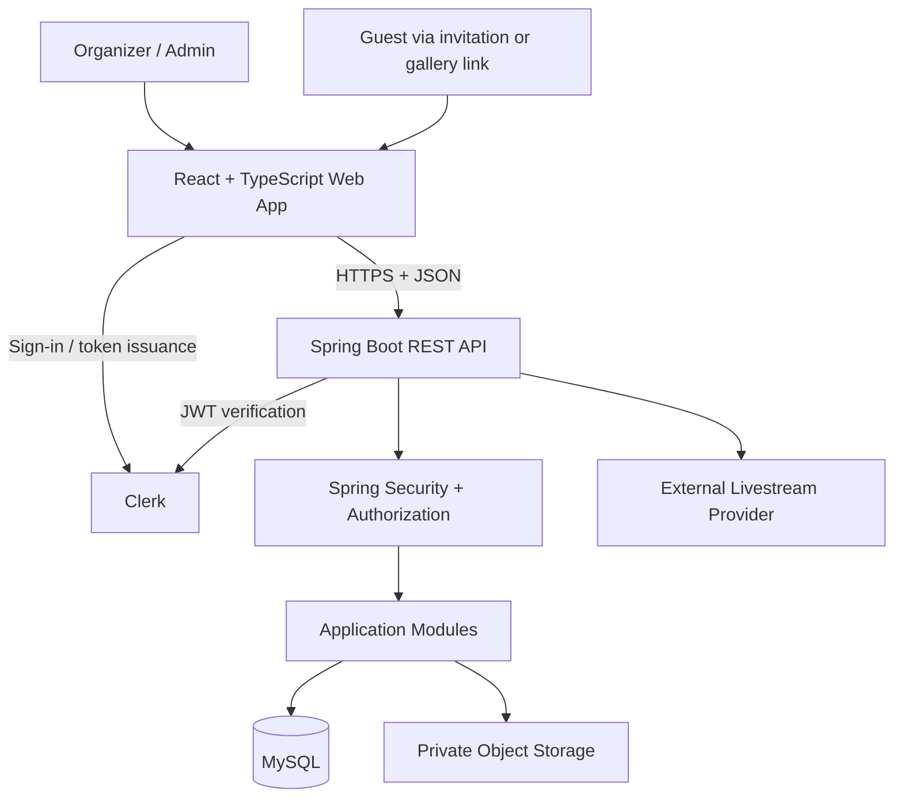
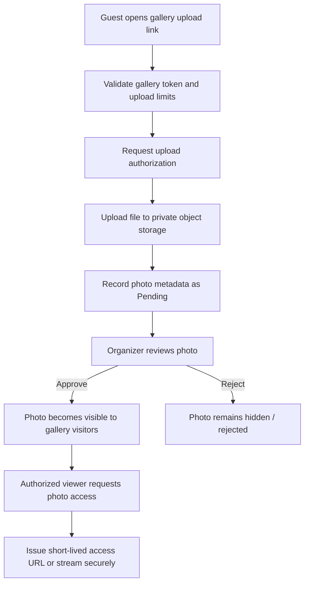

# WeddingOS — System Design

**Document version:** 1.0  
**Status:** Proposed architecture baseline  
**Audience:** Developers, reviewers, and workshop participants  
**Purpose:** Describe how WeddingOS is organized technically, how its components interact, and which implementation decisions still require validation.

---

## 1. Purpose and Scope

This document describes the proposed technical architecture for the WeddingOS MVP. It translates the product requirements into a maintainable application structure, security boundaries, data flow, deployment model, and implementation plan.

The Product Requirements Document (PRD) remains the source of truth for product scope and behavior. This document must not be used to silently introduce new product features.

### In scope

- Application architecture and component responsibilities
- Frontend-to-backend communication
- Authentication and authorization boundaries
- Data access and file-storage patterns
- Privacy and security controls
- Error handling, testing, deployment, and operations
- Architecture decisions that must be validated before implementation

### Out of scope

- Detailed relational schema, table definitions, indexes, and migrations — document these in `DBDD.md`
- Exact REST endpoint contracts and request/response payloads — document these in `API_DESIGN.md`
- Screen-level visual specifications
- Features explicitly excluded from the PRD

---

## 2. Architecture Principles

1. **Product requirements lead.** Implement only approved MVP behavior.
2. **Simple modular monolith.** Keep the API in one deployable backend application, organized into clear business modules.
3. **Secure by default.** Every private operation is authorized on the server, not merely hidden in the UI.
4. **Wedding-scoped data access.** A user must only access wedding workspaces for which they have the required membership and permissions.
5. **Guest access is deliberately limited.** Guests do not need accounts; they use high-entropy invitation or gallery links for specific guest-facing actions.
6. **Private media remains private.** Uploaded photos are not made visible to gallery visitors until approved by an authorized organizer.
7. **Keep the MVP operable at low cost.** Prefer a small number of managed services and avoid unnecessary distributed infrastructure.
8. **Use explicit contracts.** The frontend communicates with the backend through documented HTTP APIs and DTOs.
9. **Validate early.** Confirm Clerk token verification, deployment compatibility, and private file-upload flows with small proof-of-concept tests before building all modules.
10. **AI-generated changes require review.** Proposed code, schema changes, and configuration changes must be reviewed, tested, and committed intentionally.

---

## 3. Proposed Technology Direction

The following choices reflect the project decisions already made. Items marked **Open decision** are not finalized and must not be treated as selected providers.

| Concern | Proposed direction | Status / notes |
|---|---|---|
| Web frontend | React, TypeScript, Vite | Selected |
| Client-side routing | React Router | Proposed; confirm in implementation setup |
| Styling | Tailwind CSS | Proposed; confirm in implementation setup |
| Backend | Java with Spring Boot | Selected |
| API style | REST over HTTPS using JSON | Proposed |
| Authentication | Clerk | Selected |
| Backend authentication | Spring Security validates Clerk-issued JWTs | Required design; verify against the chosen Clerk configuration |
| Relational database | MySQL | Selected |
| ORM / persistence | Spring Data JPA and Hibernate | Selected |
| Schema migration | Flyway | Recommended; confirm before setup |
| API documentation | OpenAPI / Springdoc | Recommended |
| File/object storage | Cloudflare R2 | Preferred direction; validate private access and upload design before finalizing |
| Hosting | Low-cost managed hosting compatible with a Java API and MySQL | **Open decision** |
| Public domain | WeddingOS-owned domain and wedding URL format | **Open decision** |
| CI | Automated build and test checks on pull requests | Proposed |
| Testing | JUnit, Spring Boot testing, and frontend tests | Exact libraries and coverage targets to be confirmed |

Do not reintroduce the historical Next.js, Node.js, MongoDB/Mongoose, or Auth.js stack from earlier drafts. The current direction is a React frontend, Java/Spring Boot backend, and MySQL persistence.

---

## 4. High-Level Architecture

WeddingOS is a **modular monolith** with a separate web client. The browser calls the Spring Boot API over HTTPS. The API owns business rules, authorization, data validation, persistence, and the coordination of private file operations.



The diagram is conceptual. The application does not need microservices, a message broker, a dedicated real-time service, or a separate analytics platform for the MVP.

### 4.1 Component responsibilities

**Web application**
- Renders organizer dashboards, management screens, guest invitations, public wedding pages, RSVP flows, and gallery interfaces.
- Manages client-side navigation and presentation state.
- Uses Clerk for sign-in and obtains an access token for protected API requests.
- Never treats client-side route guards as the security boundary.
- Does not contain database credentials, object-storage secrets, or other server credentials.

**Clerk**
- Provides organizer identity and sign-in flows.
- Issues tokens according to the configured application.
- The backend must validate the token's signature, issuer, audience/authorized party where applicable, expiration, and other required claims according to Clerk's documented configuration.
- A decoded JWT is not a validated JWT. Do not authorize a request merely because the client sends a token.

**Spring Boot API**
- Exposes REST endpoints and validates inputs.
- Applies business rules and wedding-level authorization.
- Coordinates persistence, invitation tokens, RSVP updates, check-in, gallery moderation, and file-upload authorization.
- Returns stable response formats and safe error messages.
- Does not trust a `weddingId`, `role`, or ownership claim supplied only by the browser.

**MySQL**
- Stores structured application data, including wedding workspaces, memberships, events, tasks, family invitations, RSVP state, expenses, vendor contacts, website configuration, gallery metadata, and moderation state.
- Stores references and metadata for photos, not the photo binary itself.
- Enforces appropriate foreign-key and uniqueness constraints.

**Private object storage**
- Stores uploaded image files separately from relational records.
- Must not expose an unrestricted public bucket for private wedding photos.
- Access should be granted through short-lived signed URLs or another validated, narrowly scoped mechanism.
- The final provider and upload strategy must be validated before implementation.

**External livestream**
- WeddingOS stores a validated external livestream URL and presents it when configured.
- WeddingOS does not build or operate video-streaming infrastructure.

---

## 5. Backend Structure

Use a single Spring Boot application organized by business capability. Avoid a large collection of unrelated global controllers, services, and repositories.

Suggested package structure:

```text
services/api/
└── src/
    ├── main/
    │   ├── java/com/weddingos/
    │   │   ├── WeddingOsApplication.java
    │   │   ├── config/
    │   │   ├── security/
    │   │   ├── common/
    │   │   │   ├── error/
    │   │   │   ├── validation/
    │   │   │   └── web/
    │   │   ├── identity/
    │   │   ├── weddings/
    │   │   ├── memberships/
    │   │   ├── events/
    │   │   ├── tasks/
    │   │   ├── invitations/
    │   │   ├── rsvp/
    │   │   ├── expenses/
    │   │   ├── vendors/
    │   │   ├── website/
    │   │   ├── gallery/
    │   │   ├── checkin/
    │   │   └── livestream/
    │   └── resources/
    │       ├── application.yml
    │       └── db/migration/
    └── test/
```

Each business module should use the layers it needs:

- **Controller:** HTTP contract, authentication context, request/response mapping.
- **Service:** business rules and transaction boundaries.
- **Repository:** persistence queries.
- **Entity:** persistence model.
- **DTO:** API request/response model.
- **Mapper:** explicit conversion between persistence models and API DTOs where useful.

Do not return JPA entities directly from public API endpoints. Use DTOs to avoid leaking internal fields, coupling API responses to database structure, or exposing sensitive data.

### 5.1 Transaction boundaries

Use service-layer transactions for multi-step database changes. For example, an RSVP update should update the existing invitation/RSVP state consistently rather than create duplicate RSVP records. File operations require special care because object storage and MySQL do not share one transaction; use an explicit upload state and cleanup/retry strategy.

### 5.2 Background processing

No dedicated background-job infrastructure is required for the MVP. Avoid introducing scheduled notifications, queues, or real-time event infrastructure when the PRD explicitly excludes them.

---

## 6. Frontend Structure

Suggested web application structure:

```text
apps/web/
└── src/
    ├── app/
    │   ├── router/
    │   ├── providers/
    │   └── layouts/
    ├── components/
    │   ├── ui/
    │   └── shared/
    ├── features/
    │   ├── dashboard/
    │   ├── weddings/
    │   ├── members/
    │   ├── events/
    │   ├── tasks/
    │   ├── guests/
    │   ├── rsvp/
    │   ├── expenses/
    │   ├── vendors/
    │   ├── wedding-website/
    │   ├── gallery/
    │   ├── checkin/
    │   └── settings/
    ├── lib/
    │   ├── api-client.ts
    │   ├── auth/
    │   └── validation/
    ├── types/
    └── main.tsx
```

The exact structure may evolve, but feature boundaries should remain understandable.

### 6.1 Route categories

Organize routes into three conceptual categories:

1. **Organizer routes:** dashboard and wedding management. Require a signed-in user and server-side membership authorization.
2. **Public wedding routes:** published wedding website content only. Return only explicitly public fields.
3. **Token-based guest routes:** invitation, RSVP, gallery viewing, and upload flows. Validate the relevant token and enforce its specific scope and status.

The route names and endpoint paths will be defined in `API_DESIGN.md`. Route protection in React improves the user experience but never replaces backend authorization.

### 6.2 API client

Use a single configured API client that:
- Sets the API base URL from environment configuration.
- Adds a valid Clerk bearer token to protected requests.
- Handles common response and error formats.
- Avoids logging tokens or sensitive guest data.
- Supports cancellation or stale-request handling where appropriate.

---

## 7. Authentication and Authorization

Authentication answers **who is signed in**. Authorization answers **what that identity is allowed to do**. WeddingOS requires both.

### 7.1 Organizer authentication

1. The user signs in through Clerk.
2. The frontend obtains the appropriate token for the WeddingOS API.
3. The frontend sends the token using the `Authorization: Bearer <token>` header.
4. Spring Security validates the token using the configured Clerk-compatible verification method.
5. The backend resolves the application user identity from validated claims.
6. The backend loads the user's wedding membership and applies role and module permissions for the requested operation.

The exact Clerk JWT template, issuer/audience configuration, key retrieval/caching, and claim mapping must be confirmed against the selected Clerk setup. Implement a proof of concept before depending on assumptions about token claims.

### 7.2 Membership and roles

- A wedding workspace has Admin and Organizer roles.
- Admins manage membership and roles.
- Organizers may use modules allowed by their configured permissions.
- The backend must check membership and permissions on every protected operation.
- Do not accept a role or permission set sent from the client as authoritative.
- Prevent removing or demoting the last remaining Admin.
- All queries and mutations involving wedding-owned data must be scoped to the authorized wedding.

### 7.3 Guest access

Guests do not need accounts. Guest access is granted through purpose-specific, high-entropy tokens.

Use separate access scopes for:
- Family invitation and RSVP
- Gallery viewing
- Gallery uploads, if upload permission is distinct
- Family-level check-in, which is an organizer-only action

Do not reuse a gallery token as an invitation token or allow a guest token to access organizer APIs. Store token digests rather than raw tokens when practical, support revocation/rotation, and avoid including tokens in application logs or analytics.

---

## 8. Data Architecture

MySQL is the system of record for structured data. The detailed schema belongs in `DBDD.md`; this section describes only conceptual ownership and relationships.

### 8.1 Main domain areas

| Domain | Responsibility |
|---|---|
| User identity mapping | Maps the external identity to an internal application user |
| Wedding workspace | Core wedding details and workspace settings |
| Membership and permissions | Users, roles, and configurable module access |
| Events | Wedding events and event-specific details |
| Tasks | Preparation tasks, assignments, priorities, due dates, and statuses |
| Family invitations | Family/group invitation records, allowed events, token state, RSVP and attendee count |
| Expenses | Recorded expenses and optional event/vendor references |
| Vendor contacts | Contact details for wedding service providers |
| Wedding website | Public slug, selected theme, publication state, and approved public content |
| Gallery | Gallery configuration, token/access state, photo metadata, and moderation status |
| Check-in | Family-level check-in state and timestamp |
| Livestream | External livestream URL and configuration |

### 8.2 Data ownership rules

- Each wedding-owned record must be associated with its wedding workspace, directly or through a well-defined parent relationship.
- Family invitations represent invitation groups, not individual family members.
- A family invitation may be associated with selected events.
- An RSVP updates the existing invitation record or associated RSVP state; duplicate submissions must not create duplicate invitation groups.
- Expenses may reference an event and/or vendor, but neither reference is mandatory.
- Photo metadata stores the object key, upload status, moderation status, uploader context where available, and optional event association.
- Public website responses must be assembled from explicitly approved fields; do not serialize internal workspace records directly.

### 8.3 Consistency and constraints

The detailed database design should define:
- Foreign keys and deletion behavior
- Unique constraints for public slugs and identity mappings
- Safe uniqueness and token-lookup strategies
- Valid status values
- Amount and attendee-count constraints
- Indexes for common wedding-scoped queries
- Migration and rollback policy

The database schema must not be generated or changed independently of the reviewed `DBDD.md`.

---

## 9. File Storage and Gallery Design

The gallery is private by default, supports guest uploads without accounts, and requires organizer moderation before uploaded photos become visible to gallery visitors.

### 9.1 Proposed upload lifecycle



This is a proposed flow, not a finalized storage-provider implementation. Before building it, verify the selected storage provider's private-object access, signed URL, CORS, file-size, and upload capabilities.

### 9.2 Security and moderation requirements

- Keep the storage bucket private.
- Validate allowed file types using server-side checks; do not trust the filename or browser-supplied MIME type alone.
- Enforce file-size and upload-rate limits.
- Generate server-controlled object keys; never use an uploaded filename as a storage path.
- Restrict upload authorization to the intended gallery and allowed operation.
- Do not display pending or rejected photos to gallery visitors.
- Only authorized organizers may approve, reject, or remove photos.
- Use short-lived URLs or a similarly constrained access mechanism for private media.
- Avoid exposing storage credentials in the browser.
- Define a cleanup path for abandoned uploads and metadata records whose files were not successfully stored.
- Apply appropriate caching headers so private media is not inadvertently cached or shared.

The exact maximum file size, supported formats, upload quotas, retention policy, and signed-URL expiry are product/operations decisions that must be set before release.

---

## 10. API Design Conventions

The REST API contract will be defined separately in `API_DESIGN.md`. The following conventions should guide that document.

- Use HTTPS outside local development.
- Use JSON for ordinary request and response bodies.
- Use DTOs and validate incoming request data.
- Keep URL and payload naming consistent.
- Use explicit HTTP status codes.
- Return a consistent error envelope with a stable error code and a safe human-readable message.
- Do not return stack traces, SQL details, internal token values, or secrets.
- Use pagination for potentially large lists such as invitations and photos.
- Use filters and sorting deliberately; avoid endpoints that return an entire wedding's data in one unbounded response.
- Use idempotent or duplicate-safe behavior for operations such as RSVP updates and check-in.
- Validate all external URLs, including livestream and map links.
- Define CORS for the actual frontend origins; do not use a permissive wildcard with credentials.
- Document which endpoints require organizer authentication and which use guest tokens.

### 10.1 Suggested error categories

| Category | Typical response behavior |
|---|---|
| Validation failure | Identify invalid fields without exposing internal implementation details |
| Unauthenticated | Request sign-in or a valid guest link, as appropriate |
| Unauthorized | Deny the action without revealing private resource details |
| Not found / invalid token | Show a safe message; avoid confirming sensitive resource existence unnecessarily |
| Conflict | Explain duplicate, stale, or invalid state transitions |
| Rate limited | Ask the client to wait before retrying |
| Server failure | Return a generic error and log diagnostic details securely |

Exact status codes and response schemas belong in `API_DESIGN.md`.

---

## 11. Security and Privacy

Security must be enforced in the backend and deployment environment.

### 11.1 Core controls

- Enforce authorization on every private API operation.
- Scope all workspace queries and mutations to an authorized wedding membership.
- Validate Clerk tokens cryptographically and validate required claims.
- Keep secrets in environment configuration or a managed secret store, never in source control or client bundles.
- Validate inputs on the server, including file metadata and external URLs.
- Use parameterized persistence operations and avoid unsafe dynamic SQL.
- Apply request-size limits, upload limits, and rate limiting to token-based guest endpoints.
- Avoid logging authorization headers, raw guest tokens, signed media URLs, or unnecessary personal data.
- Protect organizer and guest contact details from public website responses.
- Prevent private gallery pages and media from being publicly indexed.
- Use HTTPS in hosted environments.
- Set appropriate security headers and restrictive CORS rules.
- Keep dependencies patched and review security-relevant upgrades.
- Ensure error messages do not disclose private wedding data or implementation details.

### 11.2 Threats to test

At minimum, test:
- One organizer attempting to access a wedding they do not belong to
- A user changing a wedding ID in a request
- A guest token used against an organizer endpoint
- An expired, revoked, malformed, or guessed token
- An upload attempt with a disallowed or oversized file
- Access to a pending or rejected photo
- An organizer attempting to manage roles without Admin permission
- Attempts to remove or demote the last Admin
- An RSVP attendee count above the invitation's configured maximum
- An unpublished or unapproved website/gallery item being exposed publicly

---

## 12. Error Handling and Observability

- Use a centralized exception-handling strategy in Spring Boot.
- Validate request DTOs and return actionable validation messages.
- Log unexpected server failures with a correlation/request ID where practical.
- Do not put raw tokens, secrets, or sensitive personal data into logs.
- Expose a minimal health endpoint for hosting-platform health checks.
- Keep operational logs sufficient to diagnose errors without turning the MVP into a complex monitoring platform.
- Define a backup and restore process for the relational database before production use.
- Document how to rotate credentials and respond to a suspected token or storage-key leak.

---

## 13. Non-Functional Design Requirements

The PRD's non-functional requirements remain authoritative. The following are implementation guidelines to be validated during development.

### Performance
- Paginate larger collections.
- Avoid loading full-resolution images into list views unnecessarily.
- Use thumbnails or appropriately sized image variants where the chosen storage/image strategy supports them.
- Add database indexes based on reviewed query patterns and measured behavior.
- Avoid expensive dashboard queries repeated separately for every metric when a consolidated approach is practical.

### Accessibility and responsiveness
- Ensure organizer workflows work on desktop and mobile.
- Prioritize mobile usability for invitations, RSVP, QR scanning, gallery viewing, and photo uploads.
- Use semantic controls, visible focus states, readable contrast, and accessible form errors.

### Reliability
- Make destructive actions explicit and confirm them where appropriate.
- Ensure RSVP updates and check-in actions are duplicate-safe.
- Define upload failure, retry, and orphan-cleanup behavior.
- Maintain database backups and test restoration before production launch.

### Maintainability
- Keep modules cohesive and avoid premature microservices.
- Use migrations for schema changes.
- Keep configuration environment-specific.
- Document API contracts, setup instructions, and operational runbooks.
- Require builds and tests to pass before merging changes.

---

## 14. Testing Strategy

Testing should verify business behavior and security boundaries, not only whether pages render.

### Frontend
- Component and form validation tests
- Loading, empty, success, and error states
- Guest invitation and RSVP flows
- Responsive behavior for core guest flows
- API error handling and authentication state

### Backend
- Unit tests for business rules
- Controller/API tests for validation and response contracts
- Repository tests for persistence behavior
- Integration tests for authorization and wedding-level data isolation
- Tests for RSVP count limits and duplicate submissions
- Tests for Admin/Organizer permissions and last-Admin protection
- Tests for gallery moderation and upload authorization

### End-to-end acceptance flows
1. Create a wedding workspace and open the dashboard.
2. Add an event and a preparation task.
3. Add a family invitation and associate it with selected events.
4. Open the invitation link as a guest and submit an RSVP.
5. Update that RSVP and verify counts remain consistent.
6. Share the invitation through a pre-filled WhatsApp message.
7. Record an expense and add a vendor contact.
8. Publish and preview the wedding website using each supported theme.
9. Upload a photo, confirm it remains hidden while pending, and approve it as an organizer.
10. Check in a family invitation and verify repeated check-in is handled safely.
11. Configure an external livestream URL and verify its presentation.
12. Attempt unauthorized access across two different wedding workspaces and confirm denial.

---

## 15. Deployment and Environments

The final hosting provider is an open decision. Choose a low-cost managed setup that supports the Java/Spring Boot API, MySQL, environment configuration, logs, HTTPS, and reliable database backups.

### 15.1 Environments

**Local development**
- React development server
- Spring Boot API
- Local or development MySQL instance
- Clerk development configuration
- Non-production object-storage bucket or a local test substitute

**Staging**
- A separately configured frontend and API deployment
- Staging database with no production guest data
- Clerk staging/development configuration
- Separate object-storage bucket and credentials
- Smoke tests before promoting a release

**Production**
- HTTPS for all public endpoints
- Production Clerk configuration
- Managed MySQL with backups and restricted credentials
- Private object storage
- Separate production secrets
- Reviewed database migrations
- Health checks, logs, and documented rollback procedures

### 15.2 Configuration

Use environment variables or managed secrets for configuration such as:
- API base URL and allowed frontend origins
- Clerk publishable configuration and server-side verification settings
- Database connection and credentials
- Object-storage endpoint, bucket, and credentials
- Public application URL
- Upload limits and signed-access expiry settings

Commit an `.env.example` containing names and safe placeholder values only. Never commit actual credentials.

### 15.3 Release checklist

- Frontend build passes.
- Backend build and automated tests pass.
- Database migration has been reviewed.
- Authentication and authorization smoke tests pass.
- Public routes expose only approved fields.
- Guest invitation, RSVP, gallery upload, moderation, and check-in flows are verified.
- Storage is private and unauthorized media access is denied.
- Backups and restoration instructions are documented.
- Environment variables and allowed origins are checked.
- Rollback procedure is known.

---

## 16. Repository and Documentation Layout

A single repository is recommended for the workshop and MVP because it keeps product documentation, frontend, backend, and quality checks together.

```text
weddingos/
├── apps/
│   └── web/
├── services/
│   └── api/
├── docs/
│   ├── PRD.md
│   ├── SYSTEM_DESIGN.md
│   ├── DBDD.md
│   ├── API_DESIGN.md
│   ├── TEST_PLAN.md
│   ├── DEPLOYMENT_RUNBOOK.md
│   ├── DECISIONS.md
│   └── workshop/
├── .github/
│   └── workflows/
├── .env.example
├── .gitignore
└── README.md
```

If the current repository uses a different structure, adapt this layout rather than moving files without a reason. Keep the PRD as the product source of truth and link related documents instead of duplicating requirements across them.

---

## 17. Implementation Sequence

Build the MVP incrementally. Each phase should produce a testable result.

### Phase 1 — Foundation and proof of concept
- Establish the repository, frontend, backend, local development, and configuration conventions.
- Validate Clerk-issued token verification in Spring Security.
- Validate a basic protected API call.
- Confirm MySQL connectivity and migration tooling.
- Confirm the chosen object-storage provider supports the required private gallery flow.

**Exit criteria:** A signed-in organizer can call a protected API successfully, and unauthenticated or invalid-token requests are denied.

### Phase 2 — Wedding workspace foundation
- Implement user identity mapping, wedding creation, membership, roles, and workspace-scoped authorization.
- Add core dashboard data and wedding details.
- Establish API error conventions and tests.

**Exit criteria:** A user can create and access only the workspace they are authorized to manage.

### Phase 3 — Events and tasks
- Implement event CRUD and preparation task workflows.
- Add validation, sorting, and task progress calculations.
- Test permissions and invalid state changes.

### Phase 4 — Family invitations and RSVP
- Implement family-level invitations and event associations.
- Implement unpredictable guest links and RSVP updates.
- Add attendee-count limits, duplicate-safe updates, WhatsApp sharing, and family-level check-in.

### Phase 5 — Expenses and vendor contacts
- Implement expense tracking and vendor contact management.
- Add dashboard totals and useful filters.

### Phase 6 — Wedding website
- Implement the three predefined themes.
- Add preview, publish, update, and unpublish behavior.
- Ensure only approved public fields are returned.

### Phase 7 — Gallery and livestream
- Implement private photo uploads, moderation, gallery links/QR codes, and access controls.
- Add external livestream configuration and presentation.
- Verify upload limits, signed access, and failure cleanup.

### Phase 8 — Hardening and release
- Complete security and end-to-end tests.
- Verify mobile usability and accessibility for critical flows.
- Configure staging, backups, health checks, and deployment runbooks.
- Complete release acceptance checks.

The order may be adjusted based on workshop goals, but authentication, authorization, and private storage risks should be validated early.

---

## 18. Architecture Decisions and Open Questions

Record decisions and their rationale in `DECISIONS.md`. Do not treat unresolved questions as approved choices.

| Decision | Current position | Next action |
|---|---|---|
| Frontend framework | React + TypeScript + Vite | Implement baseline |
| Backend framework | Java + Spring Boot | Implement baseline |
| Database | MySQL with Spring Data JPA / Hibernate | Design detailed schema in `DBDD.md` |
| Authentication | Clerk | Prove JWT validation with Spring Security |
| Object storage | Cloudflare R2 preferred | Verify private upload and access flow, then confirm |
| Hosting | Not finalized | Compare low-cost providers against API, database, backup, and deployment requirements |
| Domain and public URL | Not finalized | Confirm domain ownership and slug/URL strategy |
| Migration tool | Flyway recommended | Confirm and add migration workflow |
| API contract | Not finalized | Create `API_DESIGN.md` after reviewing domain and schema |
| Upload policy | Limits not finalized | Define file formats, size, quotas, and expiry before release |
| Guest token lifecycle | Design required | Define expiry, revocation, and rotation behavior |
| Backup/retention policy | Design required | Set retention and restore objectives before production |

### Required architecture proof of concepts

1. **Clerk + Spring Security:** Verify the actual token claims and secure API validation end to end.
2. **Wedding-level authorization:** Demonstrate that changing a wedding identifier cannot expose another wedding's records.
3. **Private gallery access:** Demonstrate guest upload, pending moderation, organizer approval, and restricted photo retrieval.
4. **Hosting compatibility:** Deploy a small Spring Boot API connected to a managed MySQL database in the proposed hosting environment.

---

## 19. Architecture Guardrails

- Do not change the approved stack without recording and reviewing a decision.
- Do not move to microservices for the MVP without a demonstrated need.
- Do not store photo binaries in MySQL.
- Do not make the gallery bucket public to simplify implementation.
- Do not trust frontend route guards for authorization.
- Do not authorize requests from unverified JWT claims.
- Do not accept workspace roles or permissions from client-supplied data.
- Do not create individual guest accounts or individual family-member records.
- Do not implement excluded PRD features as part of the MVP without approval.
- Do not expose private invitation, gallery, contact, expense, or organizer data in public responses.
- Do not disable tests or bypass security checks to make a build pass.
- Do not allow AI coding tools to silently change architecture, schema, or API contracts.

Recommended AI-assisted workflow: **propose → review the plan → generate a bounded change → run tests/build → inspect the diff → approve and commit**.

---

## 20. Definition of Architecture Readiness

The architecture is ready for detailed implementation when:

- The PRD scope and exclusions are understood and agreed.
- The Clerk-to-Spring Security token flow has been proven.
- The wedding-level authorization strategy is testable.
- The conceptual data model has been converted into a reviewed `DBDD.md`.
- The API contracts are documented in `API_DESIGN.md`.
- The private gallery storage and moderation flow has been validated.
- Hosting, domain, storage, and migration-tool decisions are recorded.
- Local setup, environment configuration, tests, and deployment steps are documented.

---

## 21. Document Governance

- `PRD.md` owns product scope, user behavior, and acceptance criteria.
- `SYSTEM_DESIGN.md` owns architecture, component responsibilities, and cross-cutting technical decisions.
- `DBDD.md` owns relational schema, constraints, indexes, and migration design.
- `API_DESIGN.md` owns endpoint contracts and API request/response behavior.
- `TEST_PLAN.md` owns detailed verification coverage.
- `DEPLOYMENT_RUNBOOK.md` owns environment setup, release, rollback, and recovery procedures.
- `DECISIONS.md` records important decisions, alternatives, rationale, and status.

When a design decision changes product behavior, update the PRD through an explicit review rather than silently changing this document.

---

**End of document**
